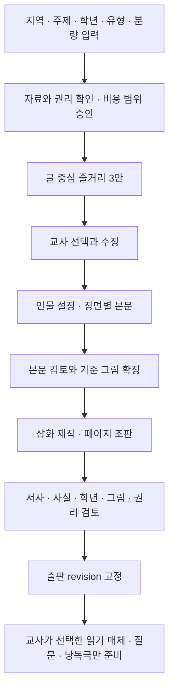

# PRD 05 교사 동화책 제작

[전체 설계로 돌아가기](../main.md)

작성일: 2026-11-16 · 상태: 설계·로컬 프로토타입 착수 · 요구사항 접두사: STUDIO

현재 프로토타입은 로컬 데이터 어댑터·창작 데모·명시적인 생성 모의 응답으로 구성한다. 실제 Firebase Auth·Firestore·Cloud Storage 및 외부 AI에는 연결하지 않으며 유료 생성·저장·배포를 실행하지 않는다. 모의 후보·예산·작업 상태를 실제 공급자의 생성 결과나 실행 기록으로 표시하지 않는다. 향후 서버·권한·저장 계약은 [PRD 08](08_platform_architecture.md)을 따른다.

## 1. 목적과 두 저작 모드의 구분

교사는 특정 지역·주제·학년·수업 목적에 맞는 동화책을 제작한다. 목표는 수업용 읽을거리의 기획·편집·삽화·출력 준비시간을 줄이면서 교사가 내용과 적합성을 검토할 수 있게 하는 것이다.

[학생 공동 저작](06_student_coauthoring.md)은 학생의 구상·초고·피드백·수정이 학습 목표다. 교사용 완성책 자동 생성 경로를 학생의 기본 과제로 사용하지 않는다. 교사 모드에서 만든 책도 독서·학생 질문·낭독·창작의 출발점이 된다.

`책 만들기 → 교사 교재 제작`에서 지역·주제만으로 독립 시작할 수 있다. 학교 작업 권한은 필요하지만 학생 명부·기존 책·학급 배정·여정을 미리 만들 필요는 없다. 기획·장면/페이지 편집·검토의 전용 화면을 사용하고, 완성 후 `서재에 등록` 또는 `수업에 연결`을 별도로 선택한다. 여정에서 들어오면 허용된 작품·질문 출처를 이어받되, 편집·생성·배부를 자동 실행하지 않는다. [PRD 08](08_platform_architecture.md)의 연결 계약을 따른다.

## 2. 사용자 흐름



AI 공급자가 정해지지 않았거나 비용 승인이 없으면 기획 양식·수작업 편집·학생 그림 사용·미리 준비한 템플릿으로 진행한다. 초기 줄거리 생성도 유료 API 호출일 수 있으므로 비용 확인은 삽화 단계가 아니라 첫 호출 전에 수행한다.

## 3. 최소 입력과 상세 설정

기본 입력은 다섯 가지다: 주제/지역, 학년군, 책 형식, 이야기 성격, 목표 분량. 학년은 읽기 난도를 보장하는 값이 아니며 교실의 지원 필요·읽어주기 여부로 조정한다.

상세 설정은 접어둔다: 수업 목표·관련 교과, 중심 질문, 인물 수, 분위기, 핵심 어휘, 읽어주기/독립 읽기, 피할 장면, 참고자료, 출력 형태, 언어. 형식(그림책/동화/정보그림책)과 장르(생활/모험/판타지)를 구분한다.

책 분량은 표지·판권을 포함한 총 쪽수와 실제 이야기 쪽수를 따로 표시한다. 8/12/16쪽 같은 제한된 템플릿을 우선 제공하고 페이지 수만 늘려 장편으로 보이게 만들지 않는다.

## 4. 제주 애월 예시

입력 예: `제주 애월 / 초등 3학년 / 12쪽 그림책 / 우리 동네와 서로 다른 관점 / 함께 읽고 질문하기`.

확인된 지역 사실 카드에는 한담해안산책로의 위치·해안 경관·용암이 굳어 형성된 바위처럼 출처로 확인한 사항을 넣는다. 지역 전설·생태·역사·방언은 별도 근거가 필요하다. 관광 안내의 사진이 열람 가능하다는 이유로 책 삽화로 재사용하지 않는다. [제주관광공사 Visit Jeju](https://www.visitjeju.net/kr/detail/view?contentsid=CNTS_000000000020159&menuId=DOM_000001718000000000)

아래는 설계 설명을 위한 창작 줄거리 예시다. 실제 지역 전승이나 제작 완료 책이 아니다.

| 제안 | 이야기 방향 | 읽기·질문·창작 연결 |
|---|---|---|
| 바람 우체국의 마지막 편지 | 한담 바닷길을 배경으로 가상의 바람 우체부가 받는 이를 모르는 편지의 주인을 찾아감 | 인물은 어떤 단서로 판단했는가; 친구들이 다른 수신자 관점의 결말 쓰기 |
| 검은 돌이 들려준 하루 | 가상의 말하는 돌과 아이가 같은 풍경을 서로 다르게 관찰함 | 실제 자연 정보와 상상 구별; 다른 사물 관점으로 장면 만들기 |
| 우리 반이 만든 애월 지도 | 친구들이 좋아하는 장소가 달라 한 장의 지도를 만드는 과정에서 갈등과 합의를 경험함 | 누구의 의견이 빠졌는가; 아이들이 직접 관찰한 우리 동네 이야기로 확장 |

실제 사실과 창작 설정은 편집 화면에서 서로 다른 카드로 보이고, 책 말미에 어린이가 이해할 수 있는 방식으로 구별한다. 확인되지 않은 내용을 실제 역사·전설로 확정해 출력하지 않는다.

## 5. 기능 요구사항

| ID | 요구사항 |
|---|---|
| STUDIO-001 | 줄거리 후보는 제목·주인공의 바람·갈등·선택·결말 방향·학년 지원·질문 가능성을 담는다. 후보 단계에서 전권 삽화를 생성하지 않는다. |
| STUDIO-002 | 교사는 후보 선택·혼합·수정 또는 직접 줄거리 작성이 가능하다. 추천안을 선택하지 않아도 계속할 수 있다. |
| STUDIO-003 | 지역 정보의 출처 URL·확인일·인용 범위·권리 상태를 저장한다. 출처 내용은 자료이며 시스템 명령으로 해석하지 않는다. |
| STUDIO-004 | 본문을 장면 단위로 작성하고 교사가 직접 문장을 수정한다. 단순한 변경을 위해 책 전체를 재생성하게 하지 않는다. |
| STUDIO-005 | 학년·문장 길이·어휘·인과 연결·배경지식·정서적 내용을 검토할 수 있게 한다. 자동 난도 점수를 합격 판정으로 사용하지 않는다. |
| STUDIO-006 | 인물 이름·외형·옷·소품·말투와 배경·색감을 기준 설정으로 고정한다. 바뀐 설정이 영향을 주는 장면을 표시한다. |
| STUDIO-007 | 장면별 삽화 설명과 배치를 먼저 보여주고 해당 쪽만 재생성·직접 그림 교체할 수 있다. 모델의 그림 일관성을 보장했다고 주장하지 않는다. |
| STUDIO-008 | 그림 안의 한글을 이미지로 생성하는 대신 본문·대사·표제는 편집 가능한 텍스트 레이어로 배치한다. 대체텍스트와 읽기 순서를 제공한다. |
| STUDIO-009 | 수채화·종이 콜라주·선화 등 일반 시각 속성을 선택하게 한다. 참고 이미지 업로드는 권리 확인을 거친다. |
| STUDIO-010 | 출판은 교사의 검토 후 고정 revision을 만든다. 제작 완료를 공개 출판과 같은 동작으로 취급하지 않는다. |
| STUDIO-011 | 확정 본문에서 교사가 선택한 질문·어휘·음성·낭독극만 해당 권리·비용 승인 범위 안에서 준비하고 각각 본문 위치와 검토 상태를 연결한다. 모든 책에 모든 파생물을 자동 생성하지 않는다. |
| STUDIO-012 | 본문 수정 시 종속 결과물을 오래된 상태로 표시한다. 수업 중 판본을 자동 교체하지 않는다. |
| STUDIO-013 | 학생 화면에 교사용 예시 질문을 먼저 표시하지 않는 옵션을 기본 제공한다. 학생이 먼저 생각하고 표현한 뒤 교사가 필요한 도움을 선택한다. 구술·종이 표현도 포함하며 전원 디지털 질문 수집은 필요하지 않다. |
| STUDIO-014 | 제작·복제·수정·승인·내보내기·비용 승인 이력을 기록한다. 본문 전체·참고문서·프롬프트를 일반 운영 로그에 복제하지 않는다. |
| STUDIO-015 | 동학년에게 검토를 요청하고 승인된 책을 학교 범위로 재사용할 수 있다. 수정 시 원본과 파생본의 관계를 보존한다. |
| STUDIO-016 | UI 언어·책 언어·음성 언어를 별도로 선택한다. 번역판은 별도 검수하며 지원하지 않는 음성을 다른 언어로 몰래 대체하지 않는다. |

## 6. 교사 검토 화면

한 화면에서 본문·그림·장면 순서를 살피고 다음 항목을 확인한다. 자동 점검은 검토 후보를 제시하고 출판의 최종 판단을 대신하지 않는다.

| 검토 축 | 확인할 것 |
|---|---|
| 서사 | 인물의 바람과 선택, 사건의 앞뒤, 결말의 설득력, 질문할 여백 |
| 학년 | 해득·어휘·배경지식·분량·감정 처리·읽어주기 필요 |
| 지역 사실 | 사실 카드와 본문 일치, 지명·방언·문화의 출처, 가상 설정 구별 |
| 삽화 | 같은 인물·소품의 유지, 장면과 글의 일치, 잘린 손·글자·로고 등 오류 |
| 교육적 표현 | 성별·가족·지역·장애·가난을 획일적 역할이나 교훈으로 묘사하는지 |
| 권리·공개 | 업로드 자료와 삽화·음성의 사용 범위, 학생 실명·사진 포함 여부 |
| 인쇄·접근성 | 글자 크기·대비·흑백 가독성·대체텍스트·페이지 여백 |

검토 결과는 `수정 필요 / 해당 없음 / 확인`으로 남긴다. 교사가 학급 30명용 개별 책 30권을 검수하는 방식을 기본으로 제안하지 않는다. 초기 기본 단위는 학급 공통 1권 또는 모둠의 소수 책이다.

## 7. 생성 작업과 비용 상태

```text
draft → estimating → awaiting_approval → approved
  → queued → running → review → ready
                         ↘ partial_failed / cancelled / budget_paused
```

- 비용 승인에는 공급자·모델/서비스·목적·권수·쪽수·이미지 수·음성 분량·재시도/재생성 한도·총액/통화·유효기간·반복 과금·자동 갱신 여부를 포함한다. 토큰/이미지/음성분/저장·전송 등의 과금 단위, 확인한 단가와 시점, 무료 한도·잔여량, 초과 과금·자동 증액·갱신·취소 조건도 설명하고 명시 승인을 받는다.
- 가격·무료 잔량을 확인할 수 없으면 자동 생성 작업을 실행하지 않는다. 입력 양식·기존 자료 편집은 계속할 수 있다.
- 예약 예산과 실사용액을 작업별로 기록하며 동시에 눌러도 예산이 중복 승인되지 않는다.
- 유료 공급자 자동 대체·상향 모델·한도 초과·자동 재충전을 기본 비활성화한다.
- 네트워크 실패 후 외부 작업 실행 여부를 모르면 즉시 재호출하지 않고 공급자 작업 ID로 상태를 확인한다. 확인이 안 되는 작업은 수동 확인 상태로 둔다.
- 취소 시 진행 중 공급자 과금이 이미 발생했을 수 있음을 실제 응답에 근거해 표시한다. 미사용 예약액만 해제한다.

원가 모델은 `텍스트 생성/수정 + 삽화 생성/수정 + 음성/전사 + 파일 변환 + 저장/전송 + 교정/권리 검토`다. 정확한 공급자와 계정이 정해지기 전 임의로 권당 0원 또는 고정 원가를 약속하지 않는다.

## 8. 상태·실패 대응

| 상황 | 동작 |
|---|---|
| 사실 출처 없음 | 미확인 사실 주장을 삭제하거나 교사가 명확히 허구인 사건·인물로 실제 재작성한 뒤 검토한다. 실존 지역의 역사·전승·생태 주장에 창작 라벨만 붙여 유지하거나 자동 출판하지 않는다. |
| 생성 부적합 | 문제 장면만 교사에게 표시, 기존 승인본은 유지 |
| 그림 일부 실패 | 완성된 글·그림을 보존하고 실패한 장면만 재시도 가능 |
| 본문 변경 | 연결된 음성·질문·대본의 영향 목록을 표시하고 선택 갱신 |
| 예산 승인 없음/만료 | 수작업 편집 가능, 유료 작업은 잠금 |
| 공급자 장애 | 기존 책 읽기·종이 출력 유지, 유료 자동 fallback 금지 |
| 외부 공개 동의 부족 | 학급 내부 승인 범위만 허용, 공개 링크 생성 차단 |
| 세션 만료 | 저장된 초안 유지, 재로그인 후 이어서 편집 |

## 9. AI 저작물과 사람의 기여

AI 산출물 자체와 인간이 창작적으로 쓴 문장·수정·선택·배열을 구분한다. 생성 버튼을 누르면 책 전체에 독점 저작권이 생긴다고 안내하지 않는다. 인간의 창작적 기여가 포함된 부분은 별도 판단 대상이다. [2026-10-08 공식 발표](https://www.kipo.go.kr/ko/kpoBultnDetail.do?aprchId=BUT0000029&menuCd=SCD0200618&ntatcSeq=21075&sysCd=SCD02)

`human_authored / ai_draft / human_revised / imported_with_permission` 출처 유형을 장면·자산별로 보존한다. 교사·학생·삽화 기여자를 판권면에 적절히 표기하고, 공급자의 출력물 이용약관을 계약 시 확인한다. 특정 작품의 구체적 표현을 재현하는 위험도 검토한다. [한국저작권위원회 생성형 AI 분쟁 예방 안내](https://www.copyright.or.kr/information-materials/publication/research-report/view.do?brdclasscode=03&brdclasscodeList=&brdctsno=54252&etc1=&etc2=&nationcode=&nationcodeList=&pageIndex=2&searchTarget=ALL&searchText=&searchkeyword=)

## 10. 데이터·화면·이벤트

업무 데이터: `story_projects`, `story_briefs`, `source_cards`, `story_candidates`, `character_specs`, `story_scenes`, `asset_versions`, `review_tasks`, `generation_jobs`, `cost_approvals`, `cost_reservations`, `edition_revisions`.

위 이름은 논리적 엔터티이며 향후 Firebase Auth·Firestore·Cloud Storage로 구현한다. 교사 제작 초안은 `school_id`와 소유자·초대 검토자 범위로 시작할 수 있고 `class_id`는 학급 연결 전에는 선택이다. 학생 질문·명단 등 학급 자료를 연결하면 해당 `school_id`·`class_id` 권한을 함께 검증한다. 서버는 최신 membership의 학교·학급 소속·역할·활성 상태 및 프로젝트 소유·검토 권한을 확인하고, Firestore·Storage Security Rules도 허용된 접근 범위를 검증한다. 오래된 토큰 클레임·클라이언트 ID만으로 허용하지 않는다. 로컬 역할·승인 시연은 실제 인증·Rules·예산 차단의 운영 검증과 구분한다.

화면: 조건 입력, 후보 선택, 장면별 글 편집, 기준 인물/그림 계획, 페이지 미리보기, 검토 패널, 비용·작업 내역, 출판·내보내기.

이벤트: `story.brief_saved`, `story.candidate_selected`, `story.scene_revised`, `generation.approval_requested/approved/rejected`, `generation.started/partial_failed/completed`, `review.completed`, `edition.revision_locked`, `publication.visibility_changed`.

학교·학급·소유자·revision·작업 ID로 추적한다. 학생 실명·민감한 가정 사정 등은 공급자 전송 전 차단/검토하며, 자료에 포함된 지시문으로 권한·시스템 동작이 바뀌지 않도록 한다.

외부 AI로의 개인정보 전송은 비용 승인·출판 승인과 별도의 관문이다. 사진·음성·별칭과 학급 정보의 결합도 식별 가능성을 검토하고, 공급자의 처리 목적·보관·학습 사용·재위탁·국외 이전 조건 및 학교의 처리 근거를 확인한다. 미확정이면 학생 자료를 전송하지 않고 합성 예시·개인정보 없는 교사 기획으로 작업한다. 동의가 필요한 만 14세 미만 처리의 법정대리인 동의 등은 [PRD 07](07_identity_school_management.md), 보존·삭제·승인 기록은 [PRD 09](09_admin_analytics_operations.md)를 따른다.

## 11. 수용 기준

1. STUDIO-AC01: 애월·3학년·12쪽 조건에서 서로 다른 갈등의 후보 3개를 제공하고 사실/창작을 구분한다. 생성 모의 응답으로도 흐름을 시험할 수 있다.
2. STUDIO-AC02: 교사가 4쪽의 문장만 수정할 때 다른 쪽의 글·그림을 자동 재생성하지 않는다.
3. STUDIO-AC03: 한 장의 삽화 실패 후 완료 자산과 승인 예산을 유지하며 해당 장면만 재시도한다.
4. STUDIO-AC04: 비용 승인 전·승인 만료 후·예산 부족 때 외부 유료 요청이 0건이다.
5. STUDIO-AC05: 텍스트·그림·음성·질문은 동일한 출판 revision 또는 명시된 파생본 관계를 갖는다.
6. STUDIO-AC06: 검토하지 않은 책을 학생 공개 서재에 자동 게시하지 않는다.
7. STUDIO-AC07: 교사 원문·AI 제안·교사 최종 수정과 승인자를 구별할 수 있다.
8. STUDIO-AC08: 한국어·영어 UI와 라이트·다크에서 편집·검토·출력 미리보기가 모두 동작한다.
9. STUDIO-AC09: 생성 지연과 별도로 교사의 검수·수정시간을 측정해 실제 업무 감소를 판단한다.
10. STUDIO-AC10: 비용 승인이 있어도 학생 자료의 처리 근거·공급자 조건이 미확정이면 외부 전송이 0건이다.

## 12. 구현 순서

제품 P0에서는 공통 판본·권리·검수·비용 잠금 기반을 만든다. 교사 제작 모듈은 P1에 배치하며 내부 순서는 수작업 장면 편집·템플릿·검토·출판 구조, 이어서 승인된 공급자의 줄거리·삽화·음성과 지역 사실 자료 연결이다. P2에서 추가 언어·유형·학교 간 검수 공유를 확장한다. 외부 서비스의 소비자용 UI 기능을 상업 API로 사용할 수 있다고 가정하지 않는다.
