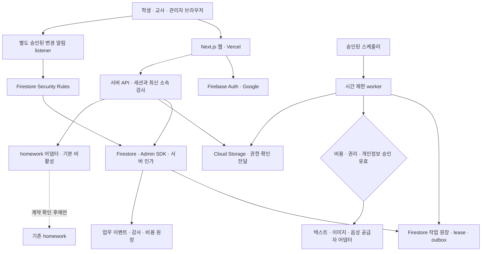

# PRD 08. 메뉴·이야기 여정·플랫폼 아키텍처

작성일: 2026-11-16 · 상태: 설계 v1.2 / 로컬 샘플 프로토타입 구현 단계 · 요구사항 접두어: `PLAT` · 개정: Firebase 문서 저장·인증·권한 경계

[전체 설계](../main.md) · [계정·권한](07_identity_school_management.md) · [관리자·운영](09_admin_analytics_operations.md) · [연동·출시](10_homework_integration_release.md)

## 1. 목적과 확정 경계

종이·웹·듣기·질문·낭독·저작이 하나의 판본과 학교 권한을 공유하는 기반을 만든다. 운영 목표는 Next.js App Router·TypeScript와 Vercel 웹/서버, Firebase Authentication·Cloud Firestore·Cloud Storage for Firebase다. 실시간 구독과 작업 전달은 별도 권한·운영 계약으로 제한한다.

현재 구현은 로컬 샘플 어댑터로 메뉴·읽기·질문·낭독·저작의 클릭 흐름을 확인하는 프로토타입이다. 실제 Firebase 계정/프로젝트 생성·조회, Google 인증, DB/Storage 연결, Rules 배포, 유료 API 호출은 하지 않는다. 아래 운영 모델은 향후 구현 계약이며 샘플 화면이 이 보안·동시성·복구 조건을 이미 충족했다는 뜻이 아니다.

reading의 운영 목표는 homework와 분리된 저장소 경로, 배포 프로젝트, Firebase 데이터·버킷·서비스 주체·OAuth 설정이다. homework의 Firebase를 재사용하거나 기존 인증 정책을 바꾸지 않는다. 개발·검증·운영 환경 분리도 비용 검토와 명시 승인 후 구성한다.

사용자가 제공한 Firebase 웹 설정과 Admin SDK 인증 자료는 로컬 `.env.local` 저장 범위로만 취급한다. 제공된 `chatnovel-e2ccb` 프로젝트가 reading 전용인지, 기존 서비스/데이터가 있는지, 과금과 무료 잔여량이 어떤지는 아직 검증하지 않았다. `FIREBASE_CONNECTION_ENABLED=false`, 분석 수집 비활성, 샘플 모드를 유지한다. 기존 프로젝트를 조회하거나 인증 정보를 시험 호출하는 행동도 별도 승인 없이 실행하지 않는다. 운영 연결 전 프로젝트 소유·독립 범위·사용 컬렉션/버킷·IAM·과금 조건을 확인한다.

## 2. 시스템 구조



위 그림은 운영 목표다. 현재 로컬 실행은 화면→도메인 계약→샘플 어댑터만 사용하며 원격 연결을 초기화하지 않는다. Firebase 서버 어댑터는 비용·대상·인증 설정 승인 후 별도로 연결한다. 어댑터 전환은 명시적 설정으로만 하며 실패 시 다른 원격 서비스나 샘플 모드로 자동 전환하지 않는다.

영구 저장은 서버 권한 검사 후 Firestore에 확정한다. 실시간 알림이나 브라우저의 낙관적 상태를 서버 저장 완료로 표시하지 않는다. 앱은 AI·음성 생성·homework 없이도 검수된 기존 책으로 수업할 수 있어야 한다.

## 3. 화면과 모듈 경계

### 3.1 세 계층과 공통 데이터

이야기 여정형을 수업 홈의 시각 방향으로 채택한다. 전체 기능을 다섯 개의 지도 버튼에 넣거나 모든 화면을 지도처럼 만들지 않는다. 다음 계층이 같은 활동·자료를 바라보도록 설계한다.

| 계층 | 담당하는 일 | 화면 원칙 |
|---|---|---|
| 전역 메뉴 | 어디서든 기능에 직접 진입, 최근 작업 다시 열기 | 일관된 명칭·현재 학교/학급·역할·언어·테마 |
| 이야기 여정 | 특정 수업에 선택한 활동과 관계, 지금 할 일 안내 | 지도/목록/시간순 보기의 동일한 수업 계획. 선택·반복·분기 허용 |
| 기능별 작업 공간 | 실제 읽기·질문·탐구·낭독·저작 | 작업에 맞는 전용 레이아웃, 기능 내부의 하위 단계 |
| 공통 자원·운영 기반 | 책 판본·학생 작업·권한·검수·파일·로그 | 진입 경로마다 별도 사본이나 다른 완료 기록을 만들지 않음 |

지도의 장소는 해당 활동의 입구다. 그 안에서 본문 읽기, 질문 개선, 대본 배역, 페이지 편집 등 세부 단계가 진행된다. 한 수업의 첫 화면과 서비스 전체의 메뉴는 별도 역할이다.

### 3.2 역할별 메뉴

| 사용자 | 기본 메뉴 | 보조·역할 전용 접근 |
|---|---|---|
| 학생 | 내 여정 / 서재 / 질문·탐구 / 낭독극 / 책 만들기 / 내 기록·작품 | 설정·도움·언어·테마, 허용된 참여 학급 전환 |
| 교사 | 수업 / 서재 / 질문·탐구 / 낭독극 / 책 만들기 / 학급·기록 | 검토함, 필요한 출력 묶음, 구성원·참여 관리, 승인된 학교 관리 |
| 학교 관리자 | 학교·구성원 / 운영 현황 / 정책·권리 / 감사·데이터 관리 | 교사 역할도 있을 때만 수업 작업 공간 추가 |
| 플랫폼 관리자 | 학교 / 콘텐츠 / 운영·비용 / 감사·지원 | 승인된 지원 범위, 일반 학생 원문 상시 조회 금지 |

학생의 `내 여정`은 배정된 여정과 최근 활동을 보여 준다. 배정이 없으면 허용된 서재·내 질문·진행 중 저작으로 이어가며 빈 지도만 보이지 않는다. 처음부터 로그인한 모든 사용자에게 동일한 지도를 보여 주지 않는다.

작은 화면·저학년 간편 보기에서는 `내 여정`, `서재`, `내 작업`처럼 표시를 묶을 수 있지만 기능의 실제 주소와 접근성은 유지한다. 장식적인 장소 이름만 쓰지 않고 `질문 광장 · 질문 만들기`처럼 기능명을 함께 제공한다. 관리자·동의·비용 설정을 학생의 탐험 장소로 넣지 않는다.

### 3.3 기능별 최적 화면과 하위 단계

| 기능 | 전용 레이아웃 | 내부에서 소화할 단계·도구 | 주요 결과물 |
|---|---|---|---|
| 서재 | 표지 격자·검색·필터·상세 패널 | 고전/교사 책/학생 책/보유 종이책, 학년·길이·주제·매체·권리, 판본 비교, 수업에 담기 | 선택한 판본 또는 서지 참조 |
| 읽기·듣기 | 본문 중심 리더, 필요할 때 여는 보조 패널 | 목차·이어 읽기·어휘·큰 글자·듣기·본문 위치·개인 메모·질문 남기기·허용 인쇄 | 위치·메모·장면 참조, 직접 만든 질문 |
| 질문·탐구 | 개인 질문 작성 → 근거와 답 시도 → 공유 보드/대화 보기 | 말/그림/글 질문, 개선·선정·재독·자료 탐색·토론·성찰, 필요한 교사/AI 도움 | 최초/수정 질문, 근거 연결, 잠정 답·남은 궁금함 |
| 낭독극 | 대본 중심 화면과 배역·연습 도구 | 대본 선택/검토·역할 분배·결원 대응·개인/짝/합창 대본·표현 선택·공유·성찰 | 검수 대본 참조·배역·해석·선택 녹음 |
| 교사 책 제작 | 단계 안내와 장면/페이지 편집기 | 지역·학년·유형 기획 → 자료 → 3안 → 글/인물 → 삽화 → 검토 → 고정본·선택 출력물 | 교사 검토 판본, 근거·권리·기여 기록 |
| 학생 공동저작 | 이야기 계획·페이지 작업대·피드백·판본 미리보기 | 기획·역할·구술/그림/글 초고·협업·친구 질문·고쳐 쓰기·내부 완성·공개 승인 | 사람의 기여가 남는 초안과 새 책 판본 |
| 내 기록·작품 | 책·질문·작품별 모음과 타임라인 | 미완성/완성 분리·피드백·출처·포트폴리오·허용 내보내기 | 기존 작업에 대한 참조; 원문 중복 저장소 아님 |
| 교사 수업 운영 | 차시 목록·활동 설정·학생 미리보기·검토함 | 작품/활동 선택·참여자·배부·모둠·관찰·필요 출력·요청 처리 | 여정 계획과 학급 실행 기록 |
| 관리자 | 권한에 맞는 관리 대시보드 | 학교·교사·학생·권리·비용·작업·감사·삭제·연동 | PRD 07·09의 운영 상태와 감사 |

질문 공간의 처음 화면은 `내 질문`이다. 친구 질문 광장·AI 예시는 수업 설정과 공개 권한에 따라 나중에 연다. 지도에서 질문 장소를 선택했다는 이유로 타인의 질문을 먼저 노출하지 않는다.

듣기·어휘·인쇄·접근성 지원은 관련 작업 안의 도구다. 교사의 빠른 제작과 학생의 학습 과정은 같은 `책 만들기` 메뉴 안에서 명확히 나누며, 학생에게 교사용 완성책 일괄 생성 흐름을 그대로 노출하지 않는다. 언어·테마·버튼/탭 표현은 공통 디자인 체계를 따르고, 화면 배치는 작업에 맞게 바꾼다. 지도·서가·리더·작업대의 여백·색상·아이콘·말투는 하나의 제품으로 느껴지게 유지한다. 앞서 만든 6개 시안의 서로 다른 색상 테마를 메뉴별로 그대로 붙인다는 뜻은 아니다.

### 3.4 독립 실행과 연계 실행

독립 실행은 여정·단원·숙제 제출을 만들지 않아도 기능이 성립한다는 뜻이다. 학교·학급·현재 권한·권리·동의·비용 조건을 없앤다는 뜻이 아니다.

| 기능 | 독립 실행의 최소 조건 | 연결할 수 있는 입력 | 연결 후에도 강제하지 않는 일 |
|---|---|---|---|
| 서재·리더 | 공개/배정/소속 권한으로 읽을 수 있는 판본 | 여정 활동, 질문의 근거 장면, 교사 공유 책 | 과제 생성, 질문 제출, 전권 완독 인증 |
| 질문·탐구 | 학생의 유효한 학급 참여와 개인 질문 세션 | 책 판본·장면, 종이책 서지/쪽수, 주제, 다른 활동의 질문 | 온라인 본문 탑재, 답 찾기, 학급 공개 |
| 낭독극 | 학급·참여자와 사용 가능한 검수 대본 | 읽던 작품/질문/장면, 기존 낭독 프로젝트 | 선행 리더 사용, 질문 단계 통과, 녹음 제출 |
| 교사 책 제작 | 승인된 교사·학교 작업 범위와 기획 | 지역·주제·자료, 기존 책/활동의 허용된 참조 | 학생 명부, 배정 수업, 출판/공개, AI 사용 |
| 학생 공동저작 | 교사가 허용한 학급/모둠 프로젝트 | 책·질문·낭독 해석 또는 원작 없는 주제 | 선행 여정, AI 삽화, 전원 디지털 입력 |
| 기록·인쇄 | 현재 접근 가능한 자원과 해당 이용권 | 어떤 경로로 만든 결과든 허용 범위에서 참조 | 전체 수업 완료, 모든 자료 출력 |

학교가 가진 종이책은 서지·판본 설명·쪽수/장면으로 질문·낭독·창작에 연결할 수 있다. 전문 업로드 권리가 없으면 리더 본문을 만들지 않는다. 종이 참여와 교사 읽어주기만으로도 여정 활동을 진행할 수 있다. 디지털 본문이 없다는 이유로 활동을 실패로 표시하지 않는다.

### 3.5 여정의 구성과 운영

교사는 `읽기와 질문`, `낭독까지`, `창작까지`, `새 책 제작 후 함께 읽기` 같은 기본 구성을 선택하고 필요한 활동을 켜거나 순서를 조정한다. 학급·판본·참여 방식·시간을 한 번 정하면 적용 가능한 활동이 이어받는다. 배역, 창작 모둠, 별도 공개처럼 다른 결정만 해당 단계에서 확인한다. 교사가 지형·좌표·선을 직접 그려야 수업을 만들 수 있는 구조는 피한다.

- **단계 수:** 시안의 다섯 장소에 고정하지 않는다. `읽기`, `질문·탐구`, `대화`, `낭독`, `저작`, `성찰·공유` 활동을 수업 목표에 맞게 조합한다. 대화는 질문 작업 공간의 토론 보기로, 성찰은 관련 활동의 성찰 보기로 열 수 있다.
- **선택과 분기:** 낭독만 하거나 창작만 선택할 수 있다. 모둠별로 다른 활동을 배정하며 자기에게 배정되지 않은 활동을 미완료로 세지 않는다.
- **반복:** 읽기→질문→재독, 질문→창작→친구 질문→수정이 가능하다. 화면을 왕복하는 일과 새로운 차시 활동을 생성하는 일을 구분한다.
- **잠금:** 기본 연결은 추천 순서다. 실제 선행 자료가 필요한 경우만 준비 조건을 둔다. 모든 학생의 질문 제출을 다음 활동의 기본 잠금 조건으로 사용하지 않는다.
- **긴 단원:** 장/차시별 구역을 묶고 현재 구역과 이어 할 일을 먼저 보여 준다. 수십 개 장소를 한 화면에 늘어놓지 않는다.
- **표시 대안:** 지도·목록·시간순 보기는 같은 활동 ID·상태·권한을 사용한다. 저속망·키보드·화면읽기 도구·작은 화면에서도 목록으로 같은 일을 할 수 있다.
- **교사 진행:** 수업 중 새 질문이 생기면 짧은 재독/대화 활동을 추가할 수 있다. 이미 만들어진 답변·초안·출력 판본은 재정렬 때문에 바뀌지 않는다.
- **과제:** 제출/마감이 필요할 때만 reading 과제에 연결한다. homework 연동은 PRD 10의 별도 계약을 따른다.

이 지도는 선택된 수업 활동의 배치다. 활동을 켜거나 장소를 추가했다고 삽화·음성·AI 질문·PDF를 자동 생성하거나 비용을 발생시키지 않는다. 비활성 기능은 교사 설정에서 이유를 보여 주고 학생에게 실행 가능한 장소처럼 표시하지 않는다.

### 3.6 작업 간 전달과 돌아오기

전용 화면에서는 지도를 접고 작은 맥락 표시를 유지한다: 현재 학급, 작품/주제, 연결된 수업이 있을 때 해당 수업, 저장 상태, `여정으로 돌아가기`. 독립 사용이면 출발점인 `서재로` 또는 `내 작업으로`를 제공한다. 허용되지 않은 다른 학급·비공개 질문 제목은 표시하지 않는다.

| 전환 | 넘기는 정보 | 사용자 확인/보호 |
|---|---|---|
| 서재 → 읽기 | 승인된 `edition_revision_id`, 열람 가능한 위치 | 판본·읽기 권리 재검사 |
| 읽기 → 내 질문 | 해당 판본·장면, 선택한 짧은 근거 참조 | 학생이 직접 질문 작성. 기본 개인 범위 |
| 질문 → 본문 재독 | 질문 ID와 해당 근거 위치 | 동일 리더에서 위치 열기, 돌아오면 질문 초안 유지 |
| 질문/대화 → 저작 | 선택한 질문 revision과 허용된 근거 | 어떤 자료를 가져올지 미리 표시, 원문·작성자·공개 범위 보존 |
| 읽기/질문 → 낭독 | 판본·장면·해석 참조 | 대본 이용권과 검수 필요, 자동 각색/유료 생성 안 함 |
| 낭독 → 저작 | 선택한 해석·대사/장면 참조 | 원문 인용·각색·새 창작 구분, 원본 대본은 유지 |
| 저작 → 읽기 | 검토된 `edition_revision_id` | 제작 완료와 배부/공개를 구분, 출판 전이면 권한 있는 미리보기 |
| 모든 작업 → 기록 | 자원·revision·허용된 활동 참조 | 권한 있는 기존 자료를 모아 보여 줌, 공개/보존 자동 연장 안 함 |

읽기 위치, 선택 질문, 배역, 페이지/장면, 허용된 초안을 저장하고 돌아왔을 때 복원한다. 다른 학급으로 전환하거나 권한이 회수되면 이전 맥락을 그대로 재사용하지 않는다. 작업을 옮기기 전에 미저장 상태를 알려 주고 저장 실패를 성공처럼 표시하지 않는다. 링크만으로 입력을 자동 제출·공개하지 않는다.

### 3.7 주소와 직접 접근 계약

아래는 신규 reading 경로다. 리더는 과제 ID 대신 판본을 중심으로 열며, 연결 활동은 선택 맥락이다. 단원 없이 시작한 활동도 안정적인 자신의 주소를 가진다.

| 영역 | 주요 경로 예시 | 역할과 책임 |
|---|---|---|
| 시작·인증 | `/[locale]`, `/[locale]/sign-in`, `/auth/callback` | 언어·테마, Google 인증, 개별 학생 참여 |
| 학생 홈·여정 | `/[locale]/learn`, `/[locale]/journeys/[journeyId]` | 배정 여정/최근 작업과 지도·목록 보기 |
| 서재·책 상세 | `/[locale]/library`, `/[locale]/books/[editionId]` | 탐색·판본 선택·이용 가능 매체 |
| 독립/연계 리더 | `/[locale]/reader/[editionRevisionId]` | 선택 `activityBindingId`·본문 anchor를 검증해 같은 리더 사용 |
| 질문·탐구 | `/[locale]/inquiry`, `/[locale]/inquiry/[sessionId]` | 개인 질문 시작·탐구·공유·대화, 과제 연결 선택 |
| 낭독극 | `/[locale]/theater`, `/[locale]/theater/[projectId]` | 검수 대본·기존 활동·배역·연습 |
| 책 제작 | `/[locale]/studio`, `/[locale]/studio/[projectId]` | 역할별 새 책/기존 프로젝트, 교사·학생 모드 구분 |
| 개인 기록 | `/[locale]/my-work` | 허용된 질문·책·기여·관찰 피드백 모음 |
| 교사 운영 | `/[locale]/teach/classes/[classId]`, `/[locale]/teach/journeys/[journeyId]` | 수업 구성·배부·검토·학급 운영 |
| 관리 | `/[locale]/admin` | 학교별·플랫폼 관리, 서버 권한 필수 |
| 운영 API | `/api/v1/...` | 버전 있는 reading 전용 계약 |

URL의 학교/학급/활동 ID와 `returnTo`는 권한 증명이 아니다. `returnTo`는 내부 허용 경로만 사용하고 학교·활동·자원·판본의 실제 관계를 서버에서 확인한다. 경로·검색·서버 렌더링·API·다운로드가 같은 규칙을 사용한다. 여정 공개 전 자료를 직접 URL로 열어 순서를 우회하는 문제는 자료의 실제 접근 권한으로 막는다. 이미 별도 열람권이 있는 공개 책에 단지 수업 순서를 이유로 가짜 보안 잠금을 걸지 않는다.

교사용 해설·검토 메모를 학생 HTML에 포함한 뒤 숨기는 방식은 금지한다. 메뉴의 표시 여부와 서버가 허용하는 기능은 같은 capability 정의를 사용하되 최종 인가는 서버가 수행한다.

### 3.8 공통 모듈과 실행 조건

서재에서 연 리더와 지도에서 연 리더는 같은 모듈이다. 모듈마다 `activity_type`, 입력 자원 종류, 결과 종류, 가능한 보기, 필요한 역할·권리, 저장/복원 방식, 선택 도구를 정의한다. 여정은 이를 조합해 보여 주고 실제 책 편집·질문 저장 로직을 복제하지 않는다.

각 기능은 실행 가능 여부를 `가능 / 자료 준비 필요 / 검토 대기 / 권한 없음 / 권리 제한 / 비용 승인 필요 / 서비스 사용 불가`처럼 구별한다. 교사는 이유와 해결 경로를 볼 수 있고 학생에게는 나이에 맞는 최소 안내를 제공한다. 여정 전체를 하나의 성공/실패 상태로 막지 않는다. AI 장애 때 직접 쓰기, 음성 장애 때 본문/종이, 지도 오류 때 활동 목록을 사용할 수 있게 한다.

## 4. 공통 식별자와 데이터 모델

### 4.1 기본 규칙

- 업무 ID는 추측하기 어려운 UUID 등으로 발급하되, 비밀 ID에 보안을 의존하지 않는다.
- `profiles.id`는 사람의 안정적인 내부 ID다. Firebase Auth UID는 `auth_bindings`를 통해 연결한다. 학생을 미리 등록해도 로그인 계정을 즉시 만들 필요가 없다.
- `school_id`는 학교 업무 행에 필수다. 자원 ID로 실제 학교를 찾고, 클라이언트가 보낸 학교 값과 현재 소속을 대조한다.
- `class_id`, `project_id`, `assignment_id`는 참조 ID다. Firestore의 FK·JOIN·고유 인덱스가 관계를 보장한다고 가정하지 않는다. 서버가 실제 상위 문서를 읽고 학교·소유자·상태를 검사하며, 관계를 바꾸는 쓰기는 관련 문서와 함께 트랜잭션으로 확정한다. 다른 학교 ID로 참조를 바꾸는 수정도 차단한다.
- 전학은 새 membership과 승인된 사본의 문제다. 기존 행의 `school_id`를 일괄 변경하지 않는다.
- `created_at/updated_at`은 서버 UTC, 표시는 사용자 시간대다. 주요 변경은 `version`과 낙관적 잠금으로 동시 수정을 검출한다.
- 업무 상태, 권리 상태, 공개 범위, 비용 승인 상태를 하나의 `status`에 섞지 않는다.

### 4.2 논리 컬렉션 묶음

다음은 신규 논리 모델이다. Firestore는 문서·컬렉션 저장소이므로 실제 문서 경로, 크기, 조회 패턴, 인덱스, 중복 필드 갱신 규칙을 정해 구현한다. 논리 엔터티를 거대한 문서 하나의 배열로 합치지 않는다. 본문 블록·페이지 revision·참여자·감사 기록은 별도 문서로 나누고 바이너리는 Storage에 둔다. [Firestore 데이터 모델](https://firebase.google.com/docs/firestore/data-model)

| 묶음 | 주요 엔터티 | 핵심 관계·제약 |
|---|---|---|
| 신원 | `profiles`, `auth_bindings`, `participation_sessions` | Auth UID→profile 연결과 앱 참여 세션을 구분. 한 UID는 동시에 한 활성 profile, 여러 승인 UID는 같은 profile 가능. 세션은 별도 scope·만료·회수 상태를 가짐 |
| 조직 | `schools`, `school_memberships`, `classes`, `class_memberships`, `groups`, `group_memberships` | 학교·학급별 역할, 담당 교사, 초대 승인, 종료일; 역할 변경 서버 전용 |
| 초대·동의 | `invitations`, `participation_tickets`, `consent_records`, `identity_link_requests` | 토큰 해시·일회성 소비, 목적·대상·기간별 동의, 병합 승인 이력 |
| 서재 원본 | `works`, `editions`, `edition_revisions`, `text_blocks` | 작품→편집/번역 판본→불변 발행 revision→장면/문단 |
| 파일·권리 | `assets`, `asset_derivations`, `rights_records`, `rights_grants` | 파일 해시·언어·revision·원본 계보; 매체/국가/기간/상업·번역·각색 권리 |
| 수업 | `reading_units`, `lesson_sessions`, `reading_assignments`, `assignment_participants` | 작품·질문·대본의 revision 고정, 대상 학생 스냅샷과 후입생 처리 |
| 여정·활동 연결 | `journey_plan_revisions`, `activity_instances`, `activity_participants`, `journey_activity_bindings`, `activity_resource_links`, `journey_edges`, `journey_activity_progress` | 여정은 `reading_units`의 실행 표현. 활동은 여정·과제 없이 존재, 연결별 배정·판본·수행 판단 분리 |
| 읽기 흔적 | `reading_positions`, `annotations`, `vocabulary_notes`, `reading_observations` | 자기보고·기기 관측·교사 관찰 구분; 종이 수업에 가짜 디지털 진행률 생성 금지 |
| 질문·탐구 | `student_questions`, `question_revisions`, `question_selections`, `evidence_links`, `inquiry_responses`, `question_reflections` | 최초 질문/개선본/도움 출처 보존, 장면 근거, 공개 범위 |
| 낭독극 | `theater_projects`, `script_revisions`, `script_lines`, `role_assignments`, `rehearsal_observations` | 원문 근거와 각색 관계, 역할·결원 대체, 녹음 별도 자산 |
| 책 제작 | `story_projects`, `story_briefs`, `story_candidates`, `story_pages`, `page_revisions`, `contributions`, `page_leases` | 교사/학생 모드, 페이지 책임, 초고·제안·최종본, 잠금 만료 |
| 검토·발행 | `review_requests`, `review_decisions`, `publications`, `export_jobs` | 검토 대상 revision 고정, 발행 범위·회수, PDF/EPUB/오디오 계보 |
| 보고서·출력 확장 | `report_template_revisions`, `report_snapshots` | PRD 15의 추가 설계. 원본 모듈의 검증된 revision 참조와 출력 내용·대상을 고정하고 `export_jobs`→`assets`로 연결; 중복 학생 응답 원장 금지 |
| 처리·비용 | `jobs`, `job_steps`, `cost_approvals`, `budget_reservations`, `usage_ledger` | 승인 범위·상한·기간, 단계별 idempotency, 추정/사용/청구 분리 |
| 추적 | `domain_events`, `audit_events`, `error_events`, `event_outbox` | 업무 추적·특권 변경·오류·전송 대기 구분, 민감 원문 복제 금지 |
| 통합 | `integration_connections`, `external_mappings`, `integration_outbox`, `integration_receipts` | 외부 ID의 시스템/학교 범위, 기능별 허용, 중복 처리 방지 |

공개 검수 서재에는 `scope=catalog` 같은 명시적인 별도 범위를 둔다. 학교별 창작 책에는 `school_id`가 필요하며, 값이 NULL이라는 이유만으로 공개하는 정책을 만들지 않는다. 공개 서재의 읽기 정책과 학교 원고·기여 기록의 정책은 분리한다.

모듈 PRD의 논리 엔터티 명칭은 아래와 같이 공통 모델에 연결한다. 같은 개념의 저장소를 모듈별로 중복 생성하지 않는다. 실제 Firestore 컬렉션·하위 컬렉션 경로는 이 공통 모델을 기준으로 확정한다.

| 모듈의 논리 명칭 | 공통 저장 모델·연결 |
|---|---|
| 02 `inquiry_units`, `inquiry_sessions`, `inquiry_attempts` | 각각 `reading_units`, `lesson_sessions`, `inquiry_responses`; `inquiry_observations`는 별도 교사 관찰 하위 엔터티 |
| 04 `theater_sessions`, `theater_casts`, `theater_observations` | 각각 `theater_projects`의 학급 실행 하위 엔터티, `role_assignments`, `rehearsal_observations`; 대본 배정·배역 변경·해석은 해당 프로젝트 하위 기록 |
| 05 `source_cards`, `character_specs`, `story_scenes` | 교사 `story_projects`의 근거·인물·서사 장면 하위 엔터티; 장면과 조판 페이지는 매핑해 구분 |
| 05 `asset_versions`, `review_tasks`, `generation_jobs`, `cost_reservations` | 각각 `assets`+계보, `review_requests`, `jobs`의 generation 유형, `budget_reservations` |
| 06 `coauthor_projects`, `book_pages`, `page_locks` | 각각 `story_projects`의 student_coauthor 모드, `story_pages`, `page_leases` |
| 06 `book_editions`, `book_artifacts` | 공통 `editions`/`edition_revisions`와 `assets`; 학생 책도 같은 읽기·출력 엔진으로 발행 |
| 06 `project_members`, `story_plans`, `writing_feedback`, `ai_suggestions`, `coauthor_observations` | 학생 저작 프로젝트의 별도 참여·기획·피드백·제안·관찰 하위 엔터티 |
| 14 `ReadingProject`, `LessonSession`, `BookRecord`, `QuestionThread` | 각각 `reading_units`, `lesson_sessions`, `works/editions` 서지 조회, 기존 질문·근거·성찰 통합 조회. PRD 14의 매핑 절을 따르며 동일 개념을 별도 저장하지 않음 |
| 15 `ActivityResponse`, `ExportSnapshot` | 응답은 각 모듈 원본의 공통 조회 계약; 기존 기록이 없는 일반 양식에만 새 응답 저장. 출력은 `report_snapshots`에 불변 내용·대상과 원본 revision 참조 보관 |

`*_profile_id`는 역할이 달라도 모두 `profiles.id`를 참조한다. 문서의 `learner_profile_id`는 학생 역할의 profile 참조이며 별도 학생 신원 테이블을 뜻하지 않는다. 페이지 저장의 `expected_revision`과 API의 `baseVersion`은 같은 낙관적 버전 조건이다. 콘텐츠의 `edition_revision_id`와 페이지/질문의 작업 revision 번호는 다른 타입으로 구분하고 이벤트에는 `resource_type`과 대응 revision을 함께 기록한다.

### 4.3 판본 계약

```text
work_id → edition_id → edition_revision_id
                             ├─ text_block_id / scene_id
                             ├─ PDF · EPUB · illustration assets
                             ├─ audio segment map
                             └─ question set / script revisions
```

편집 중 초안은 수정할 수 있지만 발행 revision은 불변이다. 원문 수정은 새 revision을 만들고 파생 자료를 `stale`로 표시한다. 이미 배정된 학급은 기존 revision을 유지한다. 교사가 교체할 때 영향받는 질문·대본·오디오와 학생 답변의 이전 기준을 확인한다.

책 언어·번역·현대어화·발췌는 별도 판본 관계다. PDF 쪽 번호는 판형마다 바뀌므로 교차 매체 참조의 기본키로 사용하지 않는다. 음성 위치와 질문은 안정적인 문단/장면 ID를 참조한다.

### 4.4 문서 경로·무결성·트랜잭션·인덱스

- 다음 경로는 논리 예시다. 운영 어댑터의 root 아래에 두며, 제공된 프로젝트의 격리가 확인되기 전에는 생성하지 않는다. 방어적 namespace 제안은 `reading/{environment}/...`이며 기존 컬렉션과 충돌을 줄이는 장치일 뿐, 별도 프로젝트·IAM·Rules 검증을 대체하지 않는다. 카탈로그·업무·로그의 상대 경로를 한 매핑에서 관리한다.
- 전역 신원은 `profiles/{profileId}`, 활성 연결은 `auth_bindings/{authUid}`처럼 UID당 단일 문서로 둔다. 연결 이력과 `participation_sessions/{sessionId}`는 별도 문서다. 세션에는 인증 UID·profile·허용 학교/학급·만료·회수·버전을 연결하고, 앱 세션 ID 보유만으로 Firebase 인증을 대신하지 않는다. 한 UID가 다른 사람의 profile에 동시에 연결되지 않도록 서버 트랜잭션이 확인한다.
- 학교 소속은 `schools/{schoolId}/memberships/{profileId}`, 학급 소속은 `schools/{schoolId}/classes/{classId}/memberships/{profileId}`처럼 범위와 사람이 정해진 경로를 사용한다. 학교 업무 자원에는 학교 ID도 보관하고 경로·필드·상위 관계 일치를 검사한다. 공개 카탈로그는 별도 namespace와 읽기 정책을 쓴다.
- ticket 소비, 소속 연결, event/outbox, 예산 예약, 작업 idempotency는 안정적인 문서 ID 또는 충돌 확인 문서와 트랜잭션으로 중복을 막는다. 입력을 읽고 조건을 검사해야 하는 작업은 transaction을 사용한다. 읽은 값에 대한 조건부 판단이 필요 없는 확정된 문서 묶음만 batched write로 원자적으로 기록한다.
- 트랜잭션 콜백은 충돌로 재실행될 수 있다. 외부 AI·메일·Storage 전송·과금 호출을 콜백 안에서 실행하지 않는다. DB 상태와 outbox만 함께 확정하고 외부 부작용은 idempotency와 별도 결과 대조로 처리한다. 중요한 권한 변경·비용 예약·학생 저장에 필요한 최신 권한은 같은 트랜잭션에서 다시 읽는다. [트랜잭션과 batched writes](https://firebase.google.com/docs/firestore/manage-data/transactions)
- 학교/학급/작성자/상태와 정렬·커서에 맞는 조회를 먼저 정하고 필요한 복합 인덱스를 버전 관리한다. 대형 본문·임의 메타데이터는 검색 요구가 없으면 불필요한 인덱싱을 줄인다. 인덱스 오류를 전체 컬렉션 읽기 후 브라우저 필터링으로 우회하지 않는다. [Firestore 인덱스](https://firebase.google.com/docs/firestore/query-data/indexing)
- 문서 ID 참조가 삭제된 상위 문서나 다른 학교를 가리키지 않도록 서버 검사와 삭제 상태를 사용한다. 부모 문서를 지워도 하위 컬렉션은 자동 삭제되지 않으므로 삭제 작업은 하위 문서·자산·보존 예외를 추적한다. 학생 삭제가 공동책 전체 삭제로 이어지지 않게 개인 데이터와 기여 표시를 분리한다. [하위 컬렉션 삭제 특성](https://firebase.google.com/docs/firestore/data-model)
- 로그·집계는 별도 컬렉션과 목적별 보존 정책을 사용한다. 매 클릭마다 하나의 전역 집계 문서를 갱신하지 않고, 학교별 집계·이벤트 원장·확정 상태의 일치와 갱신 지연을 관리한다. 대량 가져오기/삭제는 재개 가능한 작업으로 나누며 전체가 하나의 원자적 작업이라고 표시하지 않는다.

### 4.5 자원·활동·여정 연결 계약

독립 기능과 연계 기능이 함께 작동하려면 콘텐츠, 실제 작업, 수업에서의 배치를 구분해야 한다. 예를 들어 같은 고전 판본은 여러 반이 쓰지만 질문 답변·배역·관찰은 각 반의 활동에 남는다.

```text
콘텐츠/작업 자원: 책 판본 · 질문 세션 · 검수 대본 · 저작 프로젝트
        ↑ resource link: 용도 · 고정 revision · 원본 계보
활동 실행: 누가 어느 범위에서 읽고/질문하고/연습하고/만드는가
        ↑ optional binding: 배정 · 공개 시기 · 수업 안의 위치
이야기 여정: 선택된 활동과 관계를 보여 주는 수업 계획

과제/숙제 연결: 위 활동 중 실제 제출·마감이 필요한 것에만 선택 적용
```

| 엔터티/계약 | 핵심 필드와 의미 | 제약 |
|---|---|---|
| `reading_units` | 여정의 안정 ID, school/class, 제목·목표, 선택한 대표 작품 | UI의 `journey_id`는 이 ID다. 다른 이름의 중복 단원 원장을 만들지 않음 |
| `journey_plan_revisions` | 단원 ID, 활동 배치·관계·차시 설정의 revision | 계획 수정과 학생 콘텐츠 revision을 구분; 실행 중 변경의 영향 표시 |
| `activity_instances` | activity ID, school/class, module type, 실제 세션/프로젝트 참조, 실행 설정 revision | `journey_id`·`assignment_id` 필수 참조 없음. 독립 활동도 안정 ID·접근 범위를 가짐 |
| `activity_participants` | activity ID, 학생/모둠/교사 역할과 유효 상태 | 현재 소속 검사, 후입생·결원 처리. 다른 학급까지 자동 확장하지 않음 |
| `journey_activity_bindings` | binding ID와 revision, journey ID, activity ID, 배치·선택/필수 여부·공개 시기·수행 판단 정책 | 연결 변경 이력 보존, 생성/수정 권한 검사, 연결 해제와 원본 삭제 분리 |
| `activity_resource_links` | activity ID, 자원 종류/ID/revision, 입력/근거/결과 용도, 생성·복제 출처 | 실제 자원 참조 무결성·학교 경계·권리 검사. 검증 없는 임의 type/ID 저장 금지 |
| `journey_edges` | 같은 계획 안의 from/to binding, 관계 `suggested_next / related / requires_artifact` | 추천 이동과 실행 필수 조건 구분. 필수 조건의 순환은 검증에서 거부 |
| `journey_activity_progress` | binding ID와 revision, activity ID, 참여자/모둠, 상태, 근거·판단 주체·시각·정책 revision | 연결별 수업 판단. 원문·기여·책 파일을 복제하지 않음 |
| `reading_assignments` 및 외부 매핑 | 실제 제출·마감·연동이 필요한 활동의 참조 | 과제를 만들지 않고 기능을 쓰는 경로 유지, homework는 별도 계약 |

학생의 질문 세션·낭독·공동저작은 현재 학교·학급 범위를 유지한다. 개인 질문도 `visibility=private`이며 학급 소속을 잃은 임의 공개 데이터가 아니다. 교사 교재 준비는 학교 범위에서 학급 선택 전에 시작할 수 있다. 공개 카탈로그 읽기는 별도 공개 정책을 사용하며, 이 권한으로 학생 활동 기록을 읽을 수 없다. 독립 사용을 위해 학교 경계를 없애지 않는다.

기존 `lesson_sessions.unit_id`, 낭독 실행의 `unit_id`, 저작의 `assignment_id`는 선택 연결로 정리한다. 질문은 영속 질문 세션을 가지되 그 세션을 만들 때 단원·과제 생성은 요구하지 않는다. 단독 질문 메뉴에서 개인 세션을 만들거나 기존 것을 이어 열 수 있다. 공유는 별도 명시적 행동이다.

#### 재사용의 세 가지 방식

| 동작 | 결과 | 복사/변경하지 않는 것 |
|---|---|---|
| 콘텐츠 재사용 | 같은 검수 판본·대본을 참조하는 새 활동과 빈 실행 기록 | 다른 학급의 답변·관찰·배역·완료 상태 |
| 기존 활동 연결 | 같은 허용 학급/참여 범위의 작업을 여정에 참조; 기존 작업이 보임을 확인 | 학교·참여자 권한, 기존 과제, 공개·비용 승인 |
| 새 초안으로 복제 | 허용된 글/그림/구조와 필요한 출처를 새 프로젝트로 복사 | 학생 실명·개인 답변·평가·음성·불필요한 협업 이력의 자동 복사 |

다른 반에서 같은 책을 쓰는 기본 동작은 콘텐츠 재사용이다. 동일 공동책 프로젝트를 함께 편집하는 행위는 별도 공동 참여 권한과 확인이 필요하며, 수업에 담았다는 이유만으로 편집권을 얻지 않는다. 초기 범위에서는 다른 학급의 비공개 작업을 직접 연결하지 않고 권리가 확인된 고정본이나 승인된 사본을 사용한다.

책을 전에 읽었거나 프로젝트를 완성했어도 새 여정의 활동이 자동 완료되지 않는다. 기존 작업을 근거로 인정할 때 해당 수업의 수행 기준과 확인 주체를 기록한다. 개인 읽기 위치는 이어 읽기 편의에 쓰고, 수업의 참여·완독 자기보고·관찰과 구분한다.

#### 연결 후 수정·연결 해제·권한

- 배부한 책·대본·질문 세트는 고정 revision을 참조한다. 저작 중 프로젝트는 작업 대상으로 연결하되 수업에서 제출/검토하는 결과는 특정 revision으로 고정한다.
- 원본 수정은 새 revision이다. 공유된 activity의 입력 판본은 제자리에서 교체하지 않는다. 특정 수업만 새 판본을 사용하려면 새 activity instance를 만들고 해당 binding의 새 revision만 새 활동으로 전환한다. 이전 답변·근거·수행 기록은 이전 activity와 binding revision에 남으며 완료 상태를 자동 승계하지 않는다. 같은 activity를 여러 여정에 연결한다는 것은 같은 입력 판본과 작업을 공유한다는 의미다.
- 여정에서 활동을 빼면 해당 binding의 이후 노출을 중지한다. 원본 활동·학생 질문·기여·파일을 삭제하지 않고, 이미 진행한 연결의 최소 감사/근거는 보존 정책에 따라 유지한다.
- 자료 연결은 접근 권한을 넓히지 않는다. 연결할 때 자원 사용/배부 권한과 수업 관리 권한을 모두 확인한다. 실제 공개는 별도 지정한 판본·참여 범위에만 적용한다.
- 연결에 종속된 배정 권한이 해제되면 그 경로의 접근도 회수한다. 별도 개인 접근권/공개 카탈로그 권한이 있는 자원은 해당 근거가 유효한 동안 접근 가능하다. 링크 해제를 자원 전역 공개/비공개 전환으로 처리하지 않는다.
- 공개 고전과 학교 활동의 연결은 명시적 catalog→school 사용 관계다. 다른 학교 원고를 연결하기 위해 서버의 학교·상위 자원 관계 검사를 무력화하지 않는다.
- 공유 질문을 참고한 책의 공개 범위가 넓어질 때는 원래 질문 원문·학생 식별정보의 이용 범위를 다시 확인한다. 계보를 남기는 일과 모든 독자에게 원문을 공개하는 일은 다르다.

#### 이동·수행·접근 상태의 분리

지도 방문 여부는 화면 이용 기록이고 학습 수행은 별도다. 활동 수행에는 `not_started / in_progress / submitted / confirmed / participated_offline / skipped` 같은 의미를 사용하고, `미배정`은 해당 학생의 완료 분모에서 제외한다. 질문의 `아직 답을 찾지 못함`은 실패 상태가 아니다.

접근 가능 여부(배포 전·권한 없음·자료 준비 중), 자료의 검토 상태, 학생 수행 상태를 각각 저장한다. 교사 확인이 필요 없는 활동에 검토 대기열을 자동 생성하지 않는다. 선택 활동을 숨기거나 종이 참여를 인정해도 전체 화면이 영구 미완료 경고로 남지 않게 한다. 완료 비율을 표시할 경우 대상 활동·정책·기록 출처를 명시하며 읽기 능력 점수로 해석하지 않는다.

### 4.6 기능 범위와 화면 수용 검토

PRD 02의 이해 질문·학생 질문·근거 탐색·성찰은 질문 작업 공간, PRD 03의 모든 매체·권리·판본은 서재/리더와 공통 출판 도구, PRD 04의 대본·배역·연습은 낭독 작업 공간, PRD 05·06의 제작 단계는 역할에 맞는 저작 작업 공간, PRD 07·09의 조직·감사·비용은 운영 영역에 배치한다. homework는 이들 중 명시적으로 연결된 활동에 대한 외부 참조다.

기능이 많아질 때마다 지도 장소나 전역 메뉴를 추가하지 않는다. 새 기능을 `독립 목적의 작업 공간 / 기존 작업의 하위 단계 / 공통 도구 / 관리자 운영`으로 분류하고, 입력·결과·권한·독립 시작·연계 가능성을 먼저 명세한다. 지도 그림만 완성했다고 이 기능들이 구현된 것으로 보지 않는다.

## 5. Firebase 인증·서버 인가·Security Rules·Storage

### 5.1 인증과 앱 참여 세션

[PRD 07](07_identity_school_management.md)의 권한 계약을 구현 기준으로 삼는다. Google 로그인은 Firebase Authentication 제공자 흐름을 사용한다. 검증된 Firebase ID token을 서버에서 확인한 뒤 HttpOnly·Secure·SameSite 정책의 reading 전용 세션 쿠키로 교환하는 방식을 기본 운영안으로 한다. 교환 시 최근 인증·허용 origin·CSRF를 검사한다. 로컬 역할 체험은 이 흐름을 실행하지 않는다. [Google 인증](https://firebase.google.com/docs/auth/web/google-signin), [세션 쿠키](https://firebase.google.com/docs/auth/admin/manage-cookies)

Google 로그인 성공은 교사 재직·학교 가입 승인이 아니다. 서버는 Firebase 세션과 활성 `profile`, `auth_binding`, 학교/학급 membership 및 자원 참여를 확인한다. 학생의 교사 관리 참여 경로에서는 해당 `participation_session`도 검사한다. PRD 07의 학생별 티켓 검증 후 전용 UID의 custom token을 발급하고, 브라우저가 로그인해 받은 ID token을 서버 세션으로 교환한다. custom token 자체를 업무 API 인증 토큰으로 받지 않는다. 클라이언트 프로필·이메일 접미사·오래된 custom claims만으로 권한을 부여하지 않는다. [Custom token 인증](https://firebase.google.com/docs/auth/admin/create-custom-tokens)

참여 종료·공용 기기 교대·소속 회수는 앱 세션/소속의 현재 상태로 즉시 새 API 접근을 차단한다. 필요한 Firebase 전역 세션 회수는 `revokeRefreshTokens`와 서버 검증의 회수 검사로 처리하며, 쿠키 삭제만으로 모든 토큰이 무효화된다고 가정하지 않는다. 재인증 시에도 회수된 학교 권한을 복원하지 않는다. [세션 회수](https://firebase.google.com/docs/auth/admin/manage-sessions)

Firebase 세션 쿠키는 브라우저 Firestore/Storage SDK의 인증 토큰이 아니다. 운영 초기안은 API 경유 읽기·쓰기로 통일한다. 추후 직접 listener를 허용하려면 브라우저 Firebase Auth 세션과 앱 참여 세션의 대응·로그아웃·회수 검증을 별도로 구현한다. [세션 쿠키의 적용 범위](https://firebase.google.com/docs/auth/admin/manage-cookies)

### 5.2 서버와 클라이언트 권한 경계

Vercel 서버의 Admin SDK는 Firestore Security Rules를 우회한다. 따라서 모든 서버 조회·저장·목록·파일·내보내기에 공통 인가 계층을 적용한다. 자원 ID로 실제 학교와 상위 관계를 확인하고 허용 필드만 응답한다. 서버 서비스 주체는 reading 대상에 필요한 최소 IAM 권한만 가지며, 광역 소유자 권한이나 homework 서비스 계정을 사용하지 않는다. Rules가 안전하다는 이유로 Admin SDK 경로를 안전하다고 판단하지 않는다. [공식 Rules와 서버 SDK 경계](https://firebase.google.com/docs/firestore/security/rules-conditions)

클라이언트 Firestore 접근은 기본 거부한다. 미래의 직접 읽기 예외는 승인된 공개 카탈로그 또는 최소 알림 문서처럼 명시된 경로만 허용한다. 해당 규칙은 `request.auth.uid`에서 활성 신원·허용 범위를 확인하며, 사용자에게 직접 소속·권한·승인·비용·감사 문서 쓰기를 허용하지 않는다. Rules는 결과 필터가 아니므로 허용된 범위로 제한한 query와 별도의 `get/list/create/update/delete` 규칙을 함께 검증한다. [Rules 조건과 query](https://firebase.google.com/docs/firestore/security/rules-conditions)

문서 읽기를 허용하면 그 문서의 일부 민감 필드만 Rules로 숨길 수 있다고 가정하지 않는다. 보호자 정보·실명 대응표·교사 관찰·학생용 표시 데이터를 다른 문서로 나누고 서버 응답도 최소화한다. 원고·별칭·개인정보를 한 문서에 넣고 화면에서 숨기는 방식은 금지한다. [필드 접근과 문서 분리](https://firebase.google.com/docs/firestore/security/rules-fields)

### 5.3 파일 전달과 회수

Cloud Storage 파일은 비공개 전달이 기본이다. 예시 경로 `reading/{environment}/schools/{schoolId}/projects/{projectId}/assets/{assetId}`는 정리 규칙일 뿐 권한 자체가 아니다. 서버가 자산 문서·최신 소속·공개/동의 상태를 확인한 뒤 전달한다. 직접 SDK 업로드를 향후 허용할 때는 Storage Rules에서 인증·경로·크기·MIME·소유 범위를 제한하고 서버가 실제 파일과 최종 연결을 검증한다. 서버/IAM 경유 처리도 별도 인가를 거친다. [Storage Rules](https://firebase.google.com/docs/storage/security)

민감한 학생 파일은 요청마다 권한을 확인하는 전달 경로를 우선한다. 서명 URL이나 토큰이 있는 다운로드 URL은 발급 후 접근·회수 한계를 별도로 검토하고 일반 공개 링크처럼 배포하지 않는다. 업로드만 끝나고 DB 확정이 실패한 파일은 임시 상태로 두며 재조정·보존 만료 삭제로 정리한다. Firestore 문서 변경과 Storage 파일 저장이 하나의 트랜잭션이라고 가정하지 않는다.

### 5.4 Firestore listener와 저장 확정

현재 샘플 모드는 원격 listener를 생성하지 않는다. 향후에는 현재 열린 활동의 제한된 변경 신호만 구독하고, 화면 이탈·학급 전환·로그아웃 시 구독을 해제한다. 원문·학생 이름·토큰은 알림 문서나 경로에 넣지 않고 서버 API로 현재 권한을 다시 검사해 필요한 내용을 가져온다. 소속/앱 세션 회수 후 구독과 캐시가 어떻게 중지되는지 검증하기 전에는 민감 본문 직접 구독을 허용하지 않는다.

Firestore snapshot의 캐시 출처와 `hasPendingWrites`를 고려해 로컬 반영·대기·서버 확정을 구분한다. API의 확정 응답과 revision이 기준이며, 재접속 시 최신 권한·revision을 다시 확인한다. listener는 CRDT나 정확히 한 번 실행을 제공하는 기능이 아니다. [실시간 업데이트](https://firebase.google.com/docs/firestore/query-data/listen)

## 6. API 계약과 오류

아래 경로는 reading에 새로 만들 예시다. homework에 현재 존재하는 API와 혼동하지 않는다.

| API 예시 | 주요 입력·결과 | 권한·실패 조건 |
|---|---|---|
| `GET /api/v1/me/context` | profile, 현재 학교·학급·capabilities | 클라이언트 역할 주장 무시 |
| `POST /api/v1/classes/{id}/reading-assignments` | 고정 revision, 차시, 대상, 공개 범위 | 담당 교사; 작품 사용권·대상 학교 확인 |
| `POST /api/v1/inquiry-sessions` | 개인/허용 모둠 질문 세션, 선택한 책·주제·활동 참조 | 유효 학급 참여; 단원·과제 불필요 |
| `POST /api/v1/inquiry-sessions/{id}/questions` | 학생 질문, 도움 출처, 근거 위치 | 본인 참여; 타인으로 저장 불가, 과제 ID 불필요 |
| `GET /api/v1/activities/{id}/launch` | 실행 가능 기능·자료·복원 위치·선택 binding | 최신 권한 확인; 조회만으로 제출·생성 작업 시작 안 함 |
| `POST /api/v1/journeys/{id}/activity-bindings` | 기존/새 활동, 연결 방식, 배정, 계획 baseVersion | 수업 관리와 자료 이용 권한 함께 확인; 기존 작업 공유 여부 명시 |
| `DELETE /api/v1/journeys/{id}/activity-bindings/{bindingId}` | 연결 해제, 사유 | 원본 삭제 없음, 관련 배정 접근·감사·대기 작업 영향 확인 |
| `PATCH /api/v1/questions/{id}` | baseVersion, 새 질문/성찰 | 작성자 또는 명시된 피드백 경로; 원본 보존 |
| `PATCH /api/v1/story-projects/{id}/pages/{pageId}` | baseVersion, page lease, 변경 | 프로젝트·페이지 권한; 충돌 시 409 |
| `POST /api/v1/generation-jobs` | 승인 ID, 단계, revision, idempotency key | 승인 기간·공급자·예산·권리·현재 역할 확인 |
| `POST /api/v1/publications` | 검토 완료 revision, 범위, 기간 | 교사/콘텐츠 관리자; 동의·권리·검토 일치 |
| `POST /api/v1/exports` | revision, 형식, 범위 | 출력권·개인정보·예산 확인, job 반환 |
| `GET /api/v1/admin/events` | 학교 범위, 기간, trace ID | 관리자별 허용 필드·조회 감사 |
| `POST /api/v1/integrations/homework/...` | 계약된 요청만 | 기본 비활성; PRD 10의 계약 이후 구현 |

오류 응답은 `code`, 안전한 사용자 메시지, `request_id`, 재시도 가능 여부를 포함한다. 인증 실패 401, 허용되지 않은 동작 403 또는 자원 존재를 숨기는 404, 버전 충돌 409, 제한 초과 429를 구분한다. 공급자 원본 오류·토큰·DB 쿼리·학생 원문을 브라우저에 그대로 보내지 않는다.

쓰기 요청은 입력 크기·형식·권한을 서버에서 검증한다. 쿠키 인증 변경 요청은 CSRF·Origin 보호를 갖춘다. 업로드는 허용 형식·실제 파일 유형·크기·소유권을 확인하고 외부 URL 가져오기는 SSRF·과도한 용량·악성 파일을 제한한다. 도서나 업로드 문서의 문장을 시스템 명령으로 실행하지 않는다.

## 7. 공동 편집과 끊김 복구

P1의 기본안은 페이지 단위 담당자/시간 제한 lease와 낙관적 버전 검사다. 같은 페이지 동시 편집을 지원한다고 광고하기 전에 이 충돌 규칙을 제공한다.

1. 페이지를 열 때 현재 revision과 편집 권한을 가져온다.
2. 편집 lease를 취득하고 만료/갱신 상태를 표시한다. 교사가 강제 회수하면 기록을 남긴다.
3. 저장은 `baseVersion`과 idempotency key를 보낸다. 서버 트랜잭션이 권한·lease·버전을 재검사한다.
4. 충돌은 원문을 덮어쓰지 않고 내 초안·현재 저장본을 비교하게 한다. 자동 최종 저장 승자 방식으로 학생 기여를 지우지 않는다.
5. 확정 후 다른 참여자에게 변경 ID를 알리고 다시 조회한다.

향후 문자 단위 동시 편집은 CRDT 등의 추가 선택이 필요하다. Firestore listener만으로 CRDT·복원·중복 제거·충돌 해결이 자동 제공된다고 가정하지 않는다.

공용 기기에는 학생 원고를 무기한 localStorage에 남기지 않는다. 오프라인 임시 저장은 승인된 기기·보존 정책 아래 명시적으로 켜고, 재접속 시 권한·revision을 재확인한다. P0는 종이/교사 화면으로 끊김에 대응하고, 완전한 오프라인 공동편집은 후속 범위다.

## 8. 긴 작업·AI·음성·출력

이미지·TTS·PDF·EPUB을 하나의 긴 브라우저 요청에서 모두 처리하지 않는다. 서버는 job ID를 돌려주고 화면은 단계별 진행·재개·취소를 보여 준다. Firestore에는 job/step/lease/outbox 원장을 두며 실제 작업 전달·스케줄러·worker 실행은 별도 어댑터다. Firestore 컬렉션을 만들었다는 이유로 작업 큐와 재전달·처리 보장이 완성된 것으로 보지 않는다. 현재는 로컬 고정 샘플과 명시적 모의 상태 전환만 사용한다.

```text
draft → estimating → awaiting_approval → approved → queued → running
                                                   ├→ review → ready
                                                   ├→ partial_failed
                                                   ├→ cancelled
                                                   └→ budget_paused
```

- 작업 원장은 단계·입력 해시·판본·공급자·모델·승인 ID·예약 금액·시도 횟수·자산 결과를 보관한다.
- 외부 호출 직전에 현재 권한·동의·권리·비용 승인·남은 예산을 재검사한다. 예약은 원자적으로 처리해 동시 요청이 같은 잔액을 중복 사용하지 않게 한다.
- 공급자가 idempotency를 지원하면 사용하고, 응답 유실로 청구 여부가 불명확하면 재조회/수동 확인 상태로 둔다. 불명확한 실패를 무조건 재실행해 중복 청구하지 않는다.
- 전달 시스템의 visibility timeout 또는 앱 lease·worker 재시작을 고려한다. 메시지의 재전달과 외부 과금의 정확히 한 번 실행은 다르다. Firestore 결과·Storage 자산·청구를 단계별로 대조한다.
- 실패한 삽화 한 장만 다시 만들고 완료된 글·그림·음성을 재생성하지 않는다. 재시도·fallback은 승인된 공급자·기간·예산 안에서만 한다. 자동 유료 공급자 전환은 기본 금지다.
- 취소는 아직 호출하지 않은 단계를 멈춘다. 진행 중 공급자 요청의 취소·환불이 항상 가능하다고 약속하지 않는다.
- 작업 유형별 동시 실행·학교별 요청량·재시도 상한·실패 격리·보류/폐기 동작을 둔다. 운영 Firestore를 무제한 polling하는 worker는 기본 제공하지 않는다.
- 초기 개발은 고정 fixture/mock provider와 수작업 콘텐츠를 사용한다. 모의 결과는 실제 생성·실제 청구와 명확히 구별한다.

작업 생성·claim·완료 처리는 서버 전용 권한으로 제한한다. worker 호출은 검증된 스케줄러/서비스 인증을 요구하며 공개 URL이나 job ID만으로 실행하지 않는다. 전달 메시지에는 최소 job 참조만 넣고 학교·요청자·승인·원본 revision은 Firestore 원장에서 다시 읽는다. 요청한 `requester_profile_id`와 실행 서비스 주체를 별도로 감사한다. claim과 lease 갱신·완료는 트랜잭션으로 조정하되 트랜잭션 안에서 외부 호출을 하지 않는다.

초기 정책은 실행에 사용한 `auth_binding` 또는 `participation_session`의 만료·회수, 소속 회수·비용/동의 철회 시 아직 시작하지 않은 단계를 보류하는 것이다. 이는 수업 안의 `journey_activity_binding`과 다른 신원/세션 계약이다. 교사 또는 원래 요청자가 재인증해 현재 권한으로 재승인해야 재개할 수 있으며, 학생의 90분 참여 기한을 worker가 암묵적으로 연장하지 않는다. 진행 중 외부 요청은 가능한 취소를 시도하되 회수된 사용자에게 결과를 전달하지 않고 비공개 검토 상태로 둔다. 재승인 시에도 미확정 청구를 확인하고 중복 호출하지 않는다.

Vercel worker는 승인된 플랜의 함수 제한 안에서 작은 단계만 처리하고 남은 작업을 원장에 남긴다. 스케줄러나 Cloud Tasks 등 관리형 전달 서비스를 선택할 때는 제공자·호출 대상 인증·재시도·비용을 별도 검토한다. Firebase의 task queue functions는 Cloud Tasks와 Functions를 사용하는 별도 구성이지 Firestore 기본 기능이 아니며 현재 활성화하지 않는다. 웹 호스팅을 Firebase Hosting/App Hosting으로 자동 전환하지 않는다. [Firebase의 Cloud Tasks 연계](https://firebase.google.com/docs/functions/task-functions)

## 9. 다국어 설계

한국어 `ko`와 영어 `en` UI를 초기 검증 대상으로 한다. 일본어·중국어·베트남어 등 추가 언어는 실제 학교 수요와 번역 검수 역량에 따라 추가한다. 첫 버전부터 새 언어를 코드 변경 없이 메시지 카탈로그와 콘텐츠 등록으로 확장할 구조를 갖춘다.

| 구분 | 구현 계약 |
|---|---|
| UI 메시지 | 키 기반 카탈로그, 문장 단위 번역, 복수형·날짜·숫자·시간대 지원; 문자열 조각 연결 금지 |
| 사용자 선택 | 프로필/기기 선호 저장, 로그인 전 언어 선택, 변경 시 원고·읽기 위치·선택 학급 보존 |
| 문서 언어 | HTML `lang`, 콘텐츠별 언어, 장래 RTL의 `dir` 고려; 버튼 폭·줄바꿈 검증 |
| 미번역 UI | 정의된 fallback 언어 사용, 개발 검증에서 누락 키 탐지; 빈 버튼/키 문자열 노출 방지 |
| 책과 질문 | UI 언어를 바꿔도 원문을 자동 기계번역하지 않음. 번역판·질문판의 권리·검수·revision 별도 관리 |
| 음성 | 언어·발음 사전·검수 상태 표시; UI만 영어라고 한국어 본문을 영어 음성으로 읽지 않음 |
| 교사 자료 | 인쇄 계획·대본·질문지·PDF 글꼴까지 선택 언어 검증. 폰트 임베딩/재배포 권리 확인 |
| 분석 | 질문 언어와 학년을 고려한 교사 관찰; 번역문을 원문 실력으로 자동 평가하지 않음 |

일반 UI 문구 번역과 학생 작품의 번역·AI 전송은 다른 동작이다. 작품 번역에는 저작권·개인정보·비용 검토를 적용한다. 가정 언어 지원은 한국어 숙련이 낮다는 낙인이나 별도 학급 공개 표식으로 사용하지 않는다.

## 10. 라이트·다크·접근성

상단 설정에서 라이트/다크를 바로 전환하고 시스템 설정도 선택할 수 있게 한다. 최초 방문은 시스템 설정, 이후에는 명시 선택을 우선하며 로그인·재방문·언어 전환 후 유지한다. 서버 렌더링의 초기 테마를 맞춰 화면 깜박임을 줄인다.

배경·본문·보조문자·강조·오류·선택·포커스에 의미 기반 색상 토큰을 둔다. 책 표지·삽화를 CSS 반전으로 다크화하지 않는다. 읽기 영역은 별도 배경/글자 크기 조절을 제공하되 앱 테마와 충돌하지 않게 한다. PDF·인쇄 기본은 밝은 바탕이며 다크 화면을 그대로 출력하지 않는다.

키보드 탐색, 명확한 포커스, 스크린리더 이름, 확대/재배치, 애니메이션 줄이기, 색 외의 상태 표시를 지원한다. WCAG 2.2 AA를 검증 목표로 두고 일반 텍스트 4.5:1·큰 텍스트 3:1 대비 등을 확인한다. 자동 검사만으로 접근성 충족을 선언하지 않고 실제 읽기·편집·대본·관리자 흐름을 수동 검증한다. [WCAG 2.2 기준](https://www.w3.org/WAI/WCAG22/quickref/)

## 11. 설정·환경·배포 경계

| 구분 | 예시 | 원칙 |
|---|---|---|
| 공개 설정 | `NEXT_PUBLIC_FIREBASE_*` 웹 설정 | Firebase 프로젝트 식별용 설정; 데이터 접근 권한이 아니며 별도 AI API 키를 섞지 않음 |
| 서버 서비스 주체 | `FIREBASE_ADMIN_PROJECT_ID`, `FIREBASE_ADMIN_CLIENT_EMAIL`, `FIREBASE_ADMIN_PRIVATE_KEY` 또는 승인된 키 없는 인증 방식 | 서버 전용; 특히 private key는 번들·로그·저장소에 포함 금지, 실제 연결 전 IAM·대상 확인 |
| 클라우드 연결 | `FIREBASE_CONNECTION_ENABLED=false`, 로컬 샘플 모드, 분석 수집 비활성 | 설정값이 있어도 원격 SDK/로그인/DB/Storage/Analytics를 자동 실행하지 않음 |
| 실행 제한 | `PAID_OPERATIONS_ENABLED=false`, `AI_PROVIDER_MODE=mock` | 초기 상태; 서버의 승인 원장을 추가로 검사 |
| 연동 제한 | `HOMEWORK_INTEGRATION_ENABLED=false` | 계약 전 요청 전송 금지, UI 숨김만으로 대체 불가 |
| 대상 확인 | Firebase project ID·database·bucket·namespace와 Vercel project allowlist | 제공된 프로젝트의 독립 범위 확인 전 연결 금지. 웹/서버 대상 불일치·homework 대상이면 중지 |
| 환경 분리 | local / preview / staging / production | preview가 운영 학생 데이터·운영 비밀을 자동 상속하지 않음 |

`.env.local`은 버전 관리에서 제외하고 비밀값 확인을 위해 원문을 출력하지 않는다. Firebase 웹 설정의 API key는 프로젝트를 식별하는 공개 설정이며 Admin SDK private key와 다르다. 공개 설정을 감췄다는 이유로 Rules·IAM·서버 인가가 필요 없어지는 것은 아니다. [Firebase API 키](https://firebase.google.com/docs/projects/api-keys)

환경변수 변경·리소스 생성·배포도 비용을 유발하거나 확대할 수 있으므로 사용자의 비용 승인 범위를 확인한다. Firestore 문서/인덱스 읽기·쓰기·삭제, listener 재연결, Rules에서 추가 문서를 읽는 평가, 저장/전송·백업 등의 비용을 검토한다. 아직 계정 플랜·무료 잔여량·리전을 확인하지 않았으므로 무료 운영을 보장하지 않는다. [Firestore 과금](https://firebase.google.com/docs/firestore/pricing)

Firebase의 alerts-only 예산은 서비스를 멈추지 않는다. 현재 공식 문서의 spend cap 지원도 지정 서비스에 한정되므로 Firestore·Storage·Vercel 전체 청구의 강제 상한으로 해석하지 않는다. 승인 전에 실제 적용 서비스와 중지 효과·잔여 비용을 설명하고 자동 과금 전환·초과 지출·갱신을 허용하지 않는다. [예산 알림과 spend cap 범위](https://firebase.google.com/docs/projects/billing/avoid-surprise-bills)

CLI·SDK·런타임은 구현 시 호환 버전을 확인하고 lockfile에 고정한다. 로컬 샘플 검증 뒤 필요하면 가상 데이터와 Firebase Emulator Suite로 Rules·권한·동시성을 검사하되, 현재 프로토타입이 에뮬레이터 시험까지 통과했다고 주장하지 않는다. 이후에도 운영 연결·Rules/인덱스 배포 전에 프로젝트·환경·비용 승인 범위를 확인한다. [Firebase Emulator Suite](https://firebase.google.com/docs/emulator-suite)

## 12. 요구사항과 수용 기준

| ID | 필수 요구사항 | 검증 기준 |
|---|---|---|
| PLAT-001 | homework와 인프라·비밀·저장소 격리 | reading 설정에 homework DB/서비스 키·배포 대상 없음 |
| PLAT-002 | 모든 학교 업무 요청에 현재 소속 적용 | 타 학교 ID·변경된 role·회수된 binding으로 조회/쓰기 실패 |
| PLAT-003 | 판본 기반 자산·질문·과제 일치 | 본문 수정 후 기존 과제 불변, 새 파생본 검수 전 자동 교체 없음 |
| PLAT-004 | 서버·Rules·파일·listener 권한 일치 | API 차단 자원이 직접 SDK 조회/파일 신규 발급/실시간 구독으로 우회 노출되지 않음 |
| PLAT-005 | 비용 승인 없는 외부 생성 차단 | 첫 텍스트 제안부터 승인 검사, mock은 외부 호출 0건 |
| PLAT-006 | 긴 작업 재개·취소·중복 방지 | worker 중단·중복 메시지에도 완료 자산 재생성/중복 발행 없음 |
| PLAT-007 | 학생 공동 편집 충돌 보존 | 두 클라이언트 동일 버전 저장 시 조용한 덮어쓰기 없음 |
| PLAT-008 | 한국어·영어 UI 제공 | 주요 사용자 여정의 누락 키 0, 언어 전환 후 초안/위치 유지 |
| PLAT-009 | 라이트·다크·시스템 테마 | 모든 주요 화면·오류·모달·포커스 검증, 인쇄는 밝은 판형 유지 |
| PLAT-010 | 접근 가능한 읽기·질문·저작 | 키보드만으로 핵심 작업, 확대 및 화면읽기 도구 검증 |
| PLAT-011 | 개인정보 최소 수집·추적 가능 | request/trace로 흐름 복원, 이벤트에 원문·토큰·음성 미포함 |
| PLAT-012 | 안전한 비밀·배포 대상 관리 | 번들/소스맵/로그 검사와 읽기 전용 대상 점검 통과 |
| PLAT-013 | 확장 가능한 서버 계약 | 입력 검증·오류 코드·버전·idempotency·권한 기준 문서화 |
| PLAT-014 | 독립적 장애 대응 | AI·음성 생성·homework 장애 중 검수 책·기본 질문 수업 지속 |
| PLAT-015 | 데이터 생명주기·복구 | PRD 09 보존 정책에 따라 원문/파일/검색/파생물 삭제 및 복구 검증 |
| PLAT-016 | 성능·요금 가정의 실측 | 목표와 결과를 구분하고 실제 환경·플랜·사용량을 함께 기록 |
| PLAT-017 | 기능 직접 진입과 여정 진입 공존 | 과제/단원 없이 서재 읽기·개인 질문·검수 대본 낭독·새 책 제작 가능 |
| PLAT-018 | 같은 기능에 같은 모듈 사용 | 서재/지도/질문 링크가 같은 판본·리더·개인 설정을 사용, 이중 기록 없음 |
| PLAT-019 | 기능별 최적 작업 화면 | 리더·질문·낭독·저작에서 지도를 접고 해당 작업·복귀 경로 제공 |
| PLAT-020 | 단계 선택·분기·재독 | 낭독 생략·모둠 분기·질문 후 재독·창작 후 재질문 가능 |
| PLAT-021 | 자동 지도와 동등한 목록 | 교사 기본 구성 선택만으로 배치, 목록 전환 후 동일한 활동/상태/권한 |
| PLAT-022 | 안전한 맥락 전달·복원 | 읽기 위치·질문 초안·배역·페이지가 왕복 후 유지, 타 학급 맥락은 재검사 |
| PLAT-023 | 콘텐츠와 실행 재사용 구분 | 두 학급이 같은 판본을 써도 답변·배역·완료가 섞이지 않음 |
| PLAT-024 | 선택적 연결과 판본 독립 | 한 연결만 판본 교체/해제 가능, 다른 수업과 원본 기록은 유지 |
| PLAT-025 | 연결에 의한 권한 확대 차단 | 비공개 질문·원고를 연결해도 학급 전체/다른 학교에 자동 공개되지 않음 |
| PLAT-026 | 완료와 방문·종이 참여 구분 | 지도 클릭/음성 재생으로 자동 완독 처리 없음; 종이·선택 활동 정상 표시 |
| PLAT-027 | 유료 파생 작업의 명시 실행 | 활동 추가/수업 연결/지도 열기로 외부 생성 요청이 발생하지 않음 |
| PLAT-028 | 디지털 원문 없는 수업 지원 | 서지·쪽수·교사 읽어주기·검수 대본만으로 질문/낭독·창작 진행 가능 |
| PLAT-029 | 로컬 샘플과 원격 어댑터 분리 | 설정값 존재와 무관하게 샘플 모드의 Firebase/Google/AI/Analytics 원격 호출 0건 |
| PLAT-030 | Admin SDK 인가와 Rules 각각 검증 | 타 학교 API 요청 거부와 직접 클라이언트 요청 거부를 독립 시험; 서비스 IAM 범위 확인 |
| PLAT-031 | Firestore 무결성·중복 실행 방지 | ticket/연결/예산/lease 동시 요청에서 중복 확정 없음; transaction 재실행 중 외부 호출 없음 |
| PLAT-032 | 앱 세션·소속 회수 | 오래된 Firebase 토큰이 있어도 회수된 participation_session으로 새 API 접근·작업 재개 불가 |

성능의 초기 설계 목표는 30명×10학급의 동시 사용 시나리오다. 이는 검증된 수용량이 아니다. 일반 조회/저장 p95 2초 이내, 자동 저장 실패의 명확한 표시, 무한 로딩 없는 작업 상태를 목표로 하고 콜드 스타트·저사양 기기·학교망을 별도 측정한다. 생성 작업은 즉시 완료를 보장하지 않고 단계·예상 범위·취소를 제공한다. 부하 시험이 과금될 수 있으면 해당 시험 범위부터 승인받는다.

## 13. 구현 전 결정할 사항

제공된 Firebase 프로젝트의 reading 전용 여부·기존 서비스/데이터·IAM·요금제·무료 잔여량·리전·버킷·데이터 이전 조건은 미확정이다. 허용 AI 공급자와 모델·계약·보존 정책, 음성 제공 방식, 학교별 동의·보존 정책, 직접 listener의 앱 세션 연계, 관리용 MFA도 확정이 필요하다. 미확정 항목은 기능 잠금을 유지하고 로컬 샘플로 독립 개발한다. 비용 불명확 상태나 인증 자료 보유를 무료·실행 승인으로 해석하지 않는다.
