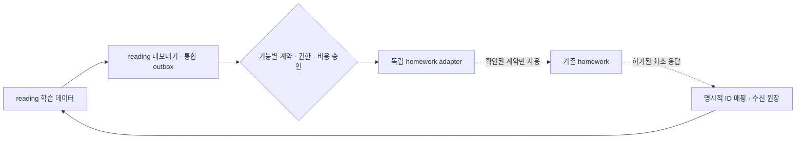

# PRD 10. homework 비파괴 연동·개발 순서·출시 검증

작성일: 2026-11-16 · 상태: 구현 전 설계 · 요구사항 접두어: `INT`, `REL`

[전체 설계](../main.md) · [신원·소속](07_identity_school_management.md) · [아키텍처](08_platform_architecture.md) · [관리자·운영](09_admin_analytics_operations.md)

## 1. 목표와 절대 경계

reading에서 만든 독서 단원·질문·낭독·책 저작 활동을 homework의 과제 운영과 연결할 수 있는 구조를 설계한다. **homework는 변경하지 않는다.** reading 단독으로 수업할 수 있어야 하며, 연동 장애나 reading의 배포·마이그레이션이 homework의 코드·데이터·인증·배포를 바꾸면 안 된다.

문서 작성·homework 일부 소스의 읽기 전용 조사에 이어 사용자가 Firebase 기준 변경과 reading 로컬 mock 프로토타입 구현을 승인했다. 실제 연동·운영 DB 조회·리소스 생성·배포·유료 호출은 별도 범위이며 수행하지 않았다. 현재 확인된 내부 API를 외부 연동 허가로 해석하지 않는다.

reading도 Firebase Auth·Firestore·Storage를 사용하도록 설계하지만 **homework와 별도 프로젝트·DB·Auth 사용자 공간·서비스 계정**이어야 한다. 사용자가 제공한 웹 설정과 서버 자격은 로컬 비밀 파일에 보관했고 원격 연결·Analytics는 비활성이다. 제공 프로젝트의 독립성·플랜·기존 데이터·리전을 검증하지 않았으므로 실제 연결 승인을 받았거나 안전한 신규 프로젝트라고 확정하지 않는다. homework 설정/키를 재사용해 이 확인을 대신하지 않는다.

### 1.1 보호 대상

- homework의 소스·패키지·lockfile·AGENTS·환경변수·배포 설정.
- Firebase Auth·Firestore·Storage·보안 규칙·인덱스·서비스 계정.
- Google OAuth 설정·기존 세션 쿠키·학생 코드·도메인/콜백.
- 학생·학급·과제·제출 이력·검토·보상·포인트와 기존 공개 자료.
- 현재 브랜치·커밋·작업 중 변경·미추적 파일.

reading 구현을 위해 homework에서 `git reset/clean`, 일괄 포맷, 의존성 설치·업그레이드, migration, 서비스 키 복사, 운영 조회, 배포를 실행하지 않는다. 필요한 참고는 읽기 범위 안에서 수행하고 코드 재사용도 별도 변경 범위·라이선스·의존성을 확인한다. 기존 프로젝트를 공용 monorepo로 옮기는 방식은 본 설계에 포함하지 않는다.

## 2. 실제 homework 조사 결과

### 2.1 조사 기준점

| 항목 | 읽기 전용 관찰 |
|---|---|
| 로컬 경로 | `C:\Users\na\Desktop\vibeproject\homework` |
| 조사일 | 2026-11-16 |
| 브랜치 | `claude/teacher-notebook` |
| HEAD | `2960f30e02e9fba1a0eb19d878935b99521547c7` |
| 기존 작업 상태 | 추적 파일 변경 51개, 미추적 항목 78개; 기존 작업을 그대로 유지 |
| 한계 | 작업트리의 일부 소스·문서 조사이며 현재 운영 배포와 일치 여부는 확인하지 않음 |

검사 대상 `package.json`, 서버 `auth.ts`, `api.ts`, `learning-links.ts` 타입/서버 파일 5개의 SHA256은 조사 중 두 시점에서 같았다. 이는 선택한 파일의 동일성을 확인한 것이며 저장소 전체·다른 프로세스의 변경까지 보증하는 검사는 아니다. 조사 도구로 homework 파일을 쓰거나 실행하지 않았다.

### 2.2 확인한 기능과 연동에 미치는 영향

아래 링크는 조사한 로컬 소스다. 이후 사용자의 다른 작업으로 줄 번호·내용이 달라질 수 있다.

| 확인 사항 | 근거 | 설계 결과 |
|---|---|---|
| Next.js 16·React 19·Firebase·Node 24, PDF-lib·Yjs 사용 | [package.json](C:/Users/na/Desktop/vibeproject/homework/package.json:14) | reading도 Firebase를 선택했지만 별도 프로젝트·권한·저장 경계를 유지 |
| Google 제공자·이메일 확인을 포함한 교사 인증 | [auth.ts](C:/Users/na/Desktop/vibeproject/homework/src/lib/server/auth.ts:25) | 같은 Google 이메일이어도 두 Firebase 프로젝트의 UID·세션·소속을 동일 식별자/권한으로 가정하지 않음 |
| 학생 코드→Firebase custom token, 상태·authVersion 검사 | [api.ts](C:/Users/na/Desktop/vibeproject/homework/src/lib/server/api.ts:233) | reading이 학생 코드를 수집하거나 재사용하지 않음 |
| `__session` HttpOnly·Secure·SameSite=Lax의 호스트 쿠키 | [api.ts](C:/Users/na/Desktop/vibeproject/homework/src/lib/server/api.ts:136) | cookie 복사·공유로 통합 로그인 구현 금지 |
| 다른 origin/cross-site의 변이 요청 차단 | [auth.ts](C:/Users/na/Desktop/vibeproject/homework/src/lib/server/auth.ts:7) | 기존 API를 reading 브라우저에서 호출 가능한 공개 API로 간주하지 않음 |
| 학급 소유 교사 권한 검사와 서버 API 경유 데이터 접근 | [policy.ts](C:/Users/na/Desktop/vibeproject/homework/src/lib/server/policy.ts:19), [firestore.rules](C:/Users/na/Desktop/vibeproject/homework/firestore.rules:65) | 기존 권한/규칙을 느슨하게 만들어 연결하지 않음 |
| 과제 생성 시 활성 학생 전체를 대상 스냅샷으로 지정 | [api.ts](C:/Users/na/Desktop/vibeproject/homework/src/lib/server/api.ts:269) | 일부 모둠 배정·후입생 추가를 지원한다고 가정하지 않음 |
| 신규 제출 유형은 text/image/video | [assignment-submission.ts](C:/Users/na/Desktop/vibeproject/homework/src/lib/assignment-submission.ts:2) | PDF·EPUB·오디오·질문별 구조화 답안을 바로 제출하는 설계 금지 |
| 참고자료는 이미지·영상, 최대 10개 | [assignment-materials.ts](C:/Users/na/Desktop/vibeproject/homework/src/lib/assignment-materials.ts:2) | reading PDF/음성을 기존 첨부 API에 넣지 않음 |
| 제출 attempt와 검토 버전 검사 | [api.ts](C:/Users/na/Desktop/vibeproject/homework/src/lib/server/api.ts:343), [검토](C:/Users/na/Desktop/vibeproject/homework/src/lib/server/api.ts:401) | 외부 완료 신호로 검토·보상을 우회 변경하지 않음 |

조사 범위에 `GET /api/me`, `GET /api/classes`, `GET /api/classes/{id}/students`, 과제 조회/생성, 학생 홈, 제출 확정, 검토 API가 존재한다. **목록의 존재는 공개 연동 계약·권한 위임·호출 승인이 있다는 뜻이 아니다.** reading은 이 경로로 탐색 요청을 보내거나 세션을 빌리지 않는다.

`firestore.rules`에 남아 있는 과거 별도 책 앱의 `bookData` 예외도 신규 온책읽기용 스키마나 연동 허가가 아니다.

### 2.3 참고할 자산과 구현되지 않은 계획

| 기존 자산 | 확인된 범위 | 과장하지 않을 경계 |
|---|---|---|
| 디지털 아트북 | 승인 작품 스냅샷, 표지·설명·PDF·음성 QR 구조 | 동화 원고/페이지 공동편집·EPUB 시스템이 완성된 것은 아님 |
| 음성 캡션 모듈 | 호스트 어댑터·교사 승인·공개 회수 구조 | 최대 60초 녹음 설명을 전권 오디오북 지원으로 확대하지 않음 |
| 함께캔버스 | 학급 참여, 이야기 활동판, 잠금·이력·복원 구상/구현 자료 | 페이지 기반 공동책 완성 기능과 구분 |
| learning-links | 과제 자료를 참여보드·투표로 연결하는 내부 스냅샷 | 외부 앱 통합·SSO·공개 webhook이 아님 |
| 말하기·읽기 스튜디오 기획 | 2026-11-04 문서에 구현 전이라고 명시 | 현재 제공되는 독서 기능 목록에 넣지 않음 |

근거: [아트북 types](C:/Users/na/Desktop/vibeproject/homework/src/modules/digital-artbook/types.ts:1), [아트북 server](C:/Users/na/Desktop/vibeproject/homework/src/modules/digital-artbook/server.ts:63), [재사용 조건](C:/Users/na/Desktop/vibeproject/homework/GALLERY_ARTBOOK_IMPLEMENTATION.md:17), [음성 모듈](C:/Users/na/Desktop/vibeproject/homework/src/modules/README.md:3), [함께캔버스](C:/Users/na/Desktop/vibeproject/homework/docs/canvas-workspace.md:7), [learning-links](C:/Users/na/Desktop/vibeproject/homework/src/lib/server/learning-links.ts:19), [읽기 스튜디오 기획](C:/Users/na/Desktop/vibeproject/homework/SPEECH_READING_STUDIO_PREBRIEF.md:3).

이 자료에서는 설계 패턴만 참고한다. 기존 모듈을 변경·이동하거나 reading이 기존 DB에 직접 쓰는 방식으로 재사용하지 않는다.

## 3. 연동 단계

| 단계 | 사용자 경험 | homework 변경 | 활성 조건 |
|---|---|---|---|
| I0 독립 사용 | reading에서 단원·책·질문·저작 운영, 결과 내보내기 | 없음 | reading 자체 기능 검증 |
| I0-L 링크 연결 | 교사가 reading의 보호된 활동 링크를 복사해 기존 과제 설명에 직접 사용 | 코드·정책 변경 없음; 교사의 기존 화면 내 콘텐츠 입력 | 링크 접근·학생 로그인 동선을 실제 확인; reading이 자동 등록하지 않음 |
| I1 최소 명부 매핑 | 승인된 명부 파일 가져오기 또는 검증된 외부 읽기 계약으로 매핑 | 기존 명시 계약이 있으면 변경 불필요; 현재 공개 계약은 미확인 | 출처·권한·개인정보·비용 확인, 교사 검토 |
| I2 상태 연동 | 계약된 완료/확인 필요 상태만 교환 | 별도 계약 필요; 현재 자동 쓰기는 미구현 | homework 소유자의 명시적 범위 승인 및 안전한 인터페이스 확보 |
| I3 고급 연동 | 더 정교한 과제 배정·회신·SSO 검토 | 현 범위 밖 | 현재의 비변경 원칙을 바꾸려면 사용자의 별도 명시 지시 필요 |

연동 대상의 기본 식별자는 reading의 독립 `activity_id` 또는 특정 여정의 `activity_binding_id`다. 질문·낭독·공동저작을 연결하기 위해 가짜 독서 과제를 만들지 않는다. `reading_assignment_id`는 reading 안에서도 실제 마감/제출 과제를 만든 경우에만 선택적으로 사용한다. 같은 활동을 여러 외부 과제에 연결한다면 외부 연결별 대상·판본·회신 상태를 각각 관리한다. 아직 homework의 외부 계약은 확인되지 않았으므로 이는 미래 계약 제안이다.

I0-L은 계정 우회 링크가 아니다. URL에는 세션·학생 코드·이름·음성 주소를 넣지 않고 불변 과제/판본 ID만 사용한다. 링크를 열면 reading이 현재 로그인과 해당 활동 권한을 확인한다. homework에서 링크 자동 인식이 안 되는 경우 복사해서 열기 등 실제 가능한 UX를 검증하고 “원클릭 통합 완료”라고 표시하지 않는다.

I1에서 가져올 파일이 homework에서 현재 제공된다고 가정하지 않는다. 학교가 적법하게 보유한 명부를 승인된 형식으로 가져올 수도 있다. 기존 서비스의 비공개 화면·쿠키를 자동 수집하는 방식은 사용하지 않는다.

PDF/EPUB/음성은 reading에서 권한 있는 다운로드·출력을 제공한다. 현재 homework 첨부 제한을 우회해 파일 확장자나 MIME을 바꾸지 않는다. 학생 결과를 homework에 제출하려면 현재 허용된 텍스트 등 형식과 학교 운영 방식 안에서 사람이 처리한다.

## 4. 어댑터와 소유권

reading 내부에 `integrations/homework` 모듈을 두고 일반 학습 도메인과 분리한다. `HOMEWORK_INTEGRATION_ENABLED=false`가 기본이며 비활성 상태에서는 네트워크 요청·자동 동기화·정기 탐색이 0건이다. 아직 계약이 없는 기능은 “연결됨”으로 표시하지 않는다.



| 데이터 | 기준 시스템 | 연동 원칙 |
|---|---|---|
| 기존 homework 학급·학생·과제·제출/검토 | homework | reading이 원본을 덮어쓰지 않음 |
| reading 학교 소속·활동 권한 | reading | 외부 명부 값만으로 관리자/교사 자동 승격하지 않음 |
| 책·판본·질문·낭독 대본·공동 원고 | reading | 외부에는 필요한 참조·요약 상태만 공유 |
| Google 제공자·Firebase 로그인 식별자 | 각 프로젝트의 인증 시스템 | 같은 스택·이메일·UID 문자열이어도 프로젝트 경계 없이 동일인/권한으로 취급하지 않음 |
| 학습 완료·관찰 | 각 시스템의 명확한 상태 | reading 완료와 homework 제출/검토 완료를 혼동하지 않음 |
| 점수·XP·포인트·보상 | homework 기존 규칙 | AI·외부 이벤트로 자동 수정하지 않음 |

`external_mappings`는 reading 전용 Firestore 컬렉션이다. `connection_id`, `source_system`, `external_school_id`, `external_class_id`, `external_user_id`, `reading_school_id`, `class_id`, `profile_id`, 확인자·확인 시각·상태를 기록한다. 인증 ID를 다룰 때는 제공 프로젝트/issuer도 포함한다. 외부 시스템에서 학교 ID를 제공하지 않으면 연결의 기관 범위를 계약으로 명시하고 임의 추정하지 않는다.

외부 ID는 연결/기관 범위와 함께 유일성을 보장한다. 이름·학번만으로 매칭하지 않고 교사에게 후보·충돌·전학·중복을 확인하게 한다. 외부 계정 삭제가 reading의 공동책 전체 삭제로 전파되지 않게 한다. 소속 회수는 접근 권한부터 신속히 반영하고 자료 삭제는 별도 근거를 따른다.

## 5. 미래 인터페이스의 최소 계약

다음은 **제안하는 계약이며 현재 homework에 존재한다고 확인된 형식이 아니다.** 인터페이스 소유자와 확인되기 전에는 구현 stub·mock 밖에서 사용하지 않는다.

### 5.1 인증·보안

- 기관별 연결과 기능별 scope: roster read, activity reference, status write 등을 분리한다. 초기 자동 write scope는 없다.
- 서버 간 제한된 권한 위임 또는 짧은 연결 승인 흐름을 별도 결정한다. 기존 사용자 세션·학생 코드·Firebase 관리자 키를 reading에 전달하지 않는다.
- 서버 credential은 reading의 전용 비밀 저장 경계에서 관리하고 최소 scope·회전·폐기·감사·유출 대응을 갖춘다.
- reading 서버의 Firebase Admin SDK는 reading project ID로만 초기화한다. ID token은 그 프로젝트의 audience/issuer로 검증하고, session cookie도 해당 프로젝트에서 발급·검증한다. homework custom token·ID token·쿠키를 reading 로그인 자격으로 받지 않는다. Firebase가 같다는 이유로 공통 인증 ID 또는 SSO가 생기지 않는다. [공식 ID token 검증](https://firebase.google.com/docs/auth/admin/verify-id-tokens)
- webhook을 채택하면 서명 본문·timestamp·nonce/event ID·issuer/audience·키 회전·허용 시간 범위를 검증하고 재전송 공격을 막는다. 단순 비공개 URL만으로 인증하지 않는다.
- 받는 `school_id`를 신뢰하지 않고 연결의 학교 범위 및 승인된 ID mapping과 대조한다.
- outbound 목적지·HTTPS·메서드를 allowlist로 제한하고 관리자가 임의 내부 주소를 입력해 SSRF를 만들지 못하게 한다.

### 5.2 메시지 예시

```json
{
  "schema_version": 1,
  "event_id": "uuid",
  "type": "reading.activity_status_changed",
  "occurred_at": "2026-11-16T00:00:00Z",
  "connection_id": "uuid",
  "external_class_id": "contract-defined-id",
  "external_student_id": "contract-defined-id",
  "external_assignment_id": "contract-defined-id",
  "reading_activity_id": "uuid",
  "activity_binding_id": "uuid-or-null",
  "reading_assignment_id": null,
  "resource_refs": [{"type": "edition_revision", "id": "uuid"}],
  "status": "teacher_review_required",
  "status_version": 3,
  "idempotency_key": "opaque-id",
  "trace_id": "opaque-id"
}
```

메시지에 학생 질문·책 원고·녹음·실명·보호자 연락처는 기본 포함하지 않는다. 예시 `status`는 reading 내부 활동의 상태이며 homework의 제출·검토·보상 상태를 직접 변경한다는 의미가 아니다. 현재 homework에 이 수신기가 없으므로 지금 전송할 대상도 없다.

`resource_refs`는 실제 연결한 고정 자료/결과 revision의 최소 참조다. 책 판본이 없는 질문·종이책·창작 활동에는 없는 판본을 필수 값으로 요구하지 않는다. 다른 여정에서의 완료·원본 책 수정·내부 연결 해제는 모든 외부 과제에 자동 전파되지 않으며 계약된 연결과 정책의 변경만 검토·회신한다.

### 5.3 동기화·실패 처리

이벤트 중복은 수신 원장의 유일키로 제거한다. 순서가 뒤바뀐 이벤트는 `status_version`으로 이전 상태 덮어쓰기를 막는다. 타임아웃을 성공/실패로 단정하지 않고 상대의 수신 확인을 대조한다. 재시도는 제한된 횟수·지수 backoff·예산 안에서 수행하고 장기 실패는 dead-letter와 교사/관리자 확인 대상으로 보낸다.

reading 완료 후 회신 실패는 “reading 완료 / homework 반영 미확인”으로 표시한다. 완료 자체를 지우거나 숙제 완료를 허위 표시하지 않는다. 계약된 철회/정정 사건도 같은 버전 규칙을 따르며 삭제된 외부 ID를 다른 학생에게 자동 재사용하지 않는다.

연동을 끄면 신규 발송을 중지하고 대기 작업을 보류한다. 다시 켤 때 폐기·재전송 범위를 확인한다. reading 내부 수업은 계속 가능해야 한다. 통합 큐·속도 제한·circuit breaker를 학습 기능과 분리해 homework 장애에 대한 반복 요청이 수업이나 비용을 압박하지 않게 한다.

## 6. 연동 요구사항과 수용 기준

| ID | 요구사항 | 수용 기준 |
|---|---|---|
| INT-001 | homework 파일·설정·데이터 비변경 | reading 작업의 쓰기 대상이 reading으로 한정되고 기존 repo에 도구 쓰기 없음 |
| INT-002 | 독립 Firebase 인프라·인증 | reading 전용 프로젝트·Auth·Firestore·Storage·서버 자격을 사용하고 homework 토큰·키·쿠키를 공유하지 않음 |
| INT-003 | 기본 비활성·기능별 허용 | disabled 상태에서 homework HTTP/DB 호출 0건 |
| INT-004 | 현재 기능과 제안 계약 구분 | 공개 API/SSO/웹훅이 미확인 상태면 해당 기능 연결 불가 표시 |
| INT-005 | 수동 링크·내보내기 우선 | 링크는 권한 검사, PDF/음성은 현재 첨부 제약 우회 없음 |
| INT-006 | 명시적 학생·학급 매핑 | 동명이인·학번 중복·전학·기관 충돌에서 자동 병합 없음 |
| INT-007 | 최소 정보 교환 | 기본 payload에 원고·질문 원문·녹음·민감정보 없음 |
| INT-008 | 불변 판본 연결 | 배부 후 새 책 수정이 기존 homework 연결 대상 내용을 바꾸지 않음 |
| INT-009 | 완료와 검토/보상 구분 | reading 활동 완료로 숙제 검토·XP를 무단 변경하지 않음 |
| INT-010 | 재전송·순서·서명 검증 | 중복·역순·오래된/잘못된 서명·타 학교 이벤트가 상태를 오염시키지 않음 |
| INT-011 | 장애 격리·중지·복구 | 연동 장애 중 수업 지속, disable 즉시 신규 발송 중지 |
| INT-012 | 비용·권한의 사전 승인 | 읽기 전용이라도 비용 불명확한 운영 API/DB 호출은 미실행 |

## 7. 개발 묶음과 의존 관계

| 순서 | 구현 묶음 | 결과물·선행 조건 |
|---|---|---|
| D0 | PRD 묶음 | main + 10개 PRD, 연구/현재 상태/제안 구분 |
| P0-A | 독립 로컬 앱 골격 | 한국어/영어·테마·데모 역할 UI, 합성 데이터, 비용 잠금; 설정이 있어도 연결 플래그 비활성 |
| P0-B | 신원·학교·Rules·서버 인가 | Firebase Google 기본 흐름, custom token/참여 세션, 개별 학생 승인, Rules와 Admin SDK 서버 권한을 별도 검증 |
| P0-C | 검수 서재·읽기 | 소수 권리 검수 작품, PDF/웹/검수 음성, 판본·접근성·기기 적은 교실 |
| P0-D | 질문·탐구·교사 운영 | 학생 최초 질문·개선·선정·근거·성찰, 종이/구술 참여, 최소 관찰 |
| P0-E | 운영 대시보드·파일럿 준비 | 학교/교사/학생 관리, 상태·추적·비용/권리 차단, 교사 준비시간 측정 |
| P1-A | 낭독극 | 원문 근거가 있는 대본, 역할·차등 대사·결원 복구, 녹음 없이 수업 가능 |
| P1-B | 교사 동화 제작 | 입력→3안→글·삽화→검수→고정 판본; 첫 외부 생성 전 비용·데이터 조건 승인 |
| P1-C | 학생 공동저작 | 역할·페이지·초고·피드백·수정·기여·발행; 교사 제작과 AI 사용 경계 분리 |
| P2-A | 운영 확장 | 검증된 추가 언어·판형·분석·규모, 승인된 백업·복구·성능 운영 |
| P2-B | 계약 기반 homework 연동 | I0-L부터 확인, 계약 없으면 I1/I2 자동화 미활성 유지 |

순서는 학교 도입 실험 결과에 따라 조정할 수 있지만 권한·비용·권리 검토를 뒤로 미루지 않는다. AI 생성 공급자를 결정하기 전에도 수작업·mock으로 화면/수업 흐름을 구현할 수 있다. 학생의 첫 질문을 AI 문제은행보다 먼저 제공하는 흐름은 P0에 포함한다.

### 7.1 로컬 구현과 연결 전환의 완료 기준

1. **로컬 시연:** 가상 학교·별칭·고정 작품·모의 생성 결과만 사용한다. 역할 선택은 화면 확인용이고 실제 Google 로그인·관리자 권한 검증이 아니라고 표시한다. 원격 Firebase/Analytics·AI 요청이 없어야 한다.
2. **로컬 보안 검증:** 필요 시 Firebase Emulator Suite의 demo 프로젝트 ID로 Auth·Firestore·Storage Rules와 서버 권한 테스트를 수행한다. 에뮬레이터가 없거나 연결 실패하면 운영 프로젝트로 fallback하지 않는다. UI 시연 통과와 Rules/서버 시험 통과는 별도 기록한다.
3. **실연결 준비:** 제공 설정이 reading 전용 프로젝트인지, Admin 자격의 대상과 범위, Auth 제공자·허용 도메인, Firestore/Storage 리전·Rules·인덱스, 플랜·무료 한도·초과 비용을 확인한다. 확인 과정 자체가 유료일 수 있는 운영 조회는 승인 전 실행하지 않는다.
4. **승인 후 연결:** 독립성과 개인정보·권리·비용 조건을 충족한 범위만 활성화한다. Google 로그인 시험 성공도 전학·세션 회수·타 학교 차단 시험을 대신하지 않는다. Cloud Storage Blaze/Billing 연결과 배포·실AI 호출은 각각 승인 범위에 포함되어야 한다.

근거: [Emulator Suite](https://firebase.google.com/docs/emulator-suite/connect_and_prototype), [Firestore Rules의 서버 SDK 예외](https://firebase.google.com/docs/firestore/security/get-started), [Storage Blaze 조건](https://firebase.google.com/docs/storage/faqs-storage-changes-announced-sept-2024).

## 8. 출시 검증 매트릭스

| ID | 실제 검증 시나리오 | 통과 조건 | 근거 PRD |
|---|---|---|---|
| REL-001 | 1~2학년 기기 없는 1차시 | 교사 화면·종이·구술로 읽기/질문 가능, 전원 입력 의무 없음 | 02·03 |
| REL-002 | 3~4학년 모둠 탐구 | 학생 질문→근거→대화→수정의 흔적, AI 답 선노출 방지 | 02 |
| REL-003 | 5~6학년 새 글 독립 질문 | 외부 도움 없이 질문·탐색 계획 제시를 관찰, 질문 수 점수화 없음 | 02 |
| REL-004 | 한 판본의 PDF·웹·음성 | 10개 장면의 참조 일치, 수정 후 기존 배정 불변 | 03·08 |
| REL-005 | 낭독극 모둠 결원·차이 | 역할 재분배·짧은 대사·무녹음 수업, 원작 해석 유지 | 04 |
| REL-006 | 애월 맞춤 동화 | 3안·사실/창작·삽화 일관성·부분 수정·검수·발행 연결 | 05 |
| REL-007 | 학생 공동책 동시 저장 | 충돌·재접속·결석 후에도 기여/초고 보존, 다수 참여 관찰 | 06 |
| REL-008 | 학교 A/B 침범 시도 | Firestore/Storage Rules 직접 접근 및 Rules를 우회하는 Admin SDK 서버 API·검색·로그·export를 각각 차단 | 07·08·09 |
| REL-009 | 소속 회수·학생 카드 재발급 | 남은 ID token/쿠키/열린 탭으로 새 저장·민감 조회·실시간 원문 수신 불가; 새 참여 세션이 이전 세션을 되살리지 않음 | 07·08 |
| REL-010 | 한국어/영어·라이트/다크 전환 | 읽기/질문/제작/관리 상태 보존, 누락 키·읽기 불가 대비 없음 | 08 |
| REL-011 | 키보드·확대·화면읽기 | 인증·독서·질문·페이지 편집·검수의 핵심 동선 완료 | 03·08 |
| REL-012 | 권리·동의 철회 | 신규 공유/출력/생성 차단, 기존 사본 한계 표시 | 03·07·09 |
| REL-013 | 비용 승인 실패·동시 작업 | 미승인/만료/초과 외부 호출 0, 이중 예약·중복 청구 방지 | 05·08·09 |
| REL-014 | provider timeout·worker 중단 | 완료 자산 보존, 불명확 청구의 무조건 재실행 없음 | 08·09 |
| REL-015 | 로그 추적·원문 최소화 | 한 단원의 주요 상태를 복원하고 민감정보를 로그에 복제하지 않음 | 09 |
| REL-016 | homework 완전 비연결/장애 | reading 수업 지속, 기존 프로젝트 변경·호출 없음/계약된 제한 준수 | 10 |
| REL-017 | 명부 중복·전학·학기 마감 | 이름 자동 병합·타 학교 재귀속·과거 자료 자동 공개 없음 | 07·09·10 |
| REL-018 | 보존 만료·백업 복원 | 파일·파생본·삭제 표식·학교 권한이 일관됨 | 08·09 |
| REL-019 | 교사 총 운영시간 | 제작시간만이 아니라 검수·기기 대응·평가까지 비교 | 01·02·05 |
| REL-020 | 실제 배포 대상 확인 | reading 전용 Firebase projectId/Auth/Firestore/Storage/Admin 자격·도메인·비용 승인 범위 일치, homework 자격 거부 | 07·08·10 |
| REL-021 | 여정 없이 기능 사용 | 독립 읽기·질문·낭독·교사 제작·학생 저작에서 가짜 단원/과제 생성 없음 | 02~06·08 |
| REL-022 | 독립 작업의 후속 수업 연결 | 단독 시작→저장→허용된 두 수업 연결→한 연결만 새 판본 적용→한 연결 해제, 원본/다른 수업 유지 | 08 |
| REL-023 | 같은 판본의 두 학급 사용 | 콘텐츠만 공유하고 질문·배역·관찰·완료는 각 학급에서 분리 | 07·08 |
| REL-024 | 작업 공간 왕복 | 지도→리더→내 질문→근거 재독→여정 복귀 후 위치·초안·맥락 유지 | 02·03·08 |
| REL-025 | 선택·분기·종이 참여 | 낭독 생략·모둠별 창작/대화·미해결 질문·교사 읽어주기를 정상 진행으로 표시 | 02·04·06·08 |
| REL-026 | 지도·목록·시간순의 동등성 | 같은 활동/권한/상태 제공, 키보드로 지도 없이 모든 핵심 활동 진입 | 08 |
| REL-027 | 연결 경계 | 활동 추가/연결만으로 원고 공개·학생 권한 확대·AI 호출·자동 homework 쓰기 없음 | 07~10 |
| REL-028 | 로컬 mock과 실제 보안 구분 | 데모 역할을 바꾸어도 운영 API 권한으로 인정되지 않고 연결 비활성 상태의 Firebase/Analytics 요청 0건 | 07·09·10 |
| REL-029 | Firebase 비용 조건 | Storage의 Blaze 요구·예산 알림/서비스별 spend cap의 범위를 정확히 표시하고 미승인 Billing 연결·초과 활성화 없음 | 09·10 |

이 표는 향후 구현의 검증 계획이며 지금 실행·통과한 테스트 목록이 아니다. 출시 전 실제 결과·환경·사용 계정 유형·실패와 해결을 기록한다. 유료 부하 시험·AI 호출·호스팅 생성은 시험 목적이라도 먼저 비용 승인을 받는다.

## 9. 파일럿과 출시 판단

[PRD 01](01_product_research.md)의 제안은 초등 6개 학년을 포함하는 약 12학급·6~8주 파일럿이다. 모집·일정·실제 연구 설계는 아직 확정하지 않았다. 학년·기기 환경·교사 경험·읽기 지원 필요가 다른 학급을 포함하고, 디지털 참여 학생만 평가 표본에 남는 편향을 줄인다.

출시 판단은 다음을 함께 본다.

1. **수업 성립:** 종이·듣기·웹 중 어느 경로든 같은 이야기 대화에 참여한다.
2. **질문의 자립성:** 새 글에서 도움 없는 질문·근거 탐색을 관찰한다. 단기 클릭 증가를 장기 역량 향상으로 해석하지 않는다.
3. **교사 부담:** 자료 준비 감소가 검수·오류 대응·채점 증가로 상쇄되지 않는다. 총시간 30% 감소는 검증할 목표이지 입증된 효과가 아니다.
4. **책의 품질:** 고전의 권리·현대어화 표시, 지역 사실, 삽화·본문·음성 일치, 학생 기여가 확인된다.
5. **운영 조건:** 학교 격리·권한 회수·비용 통제·삭제·복구·homework 비변경 조건을 충족한다.

학생 정보 노출, 미확인 권리의 배포, 승인 없는 과금, homework 변경/오염, 판본 불일치로 인한 수업 오류가 있으면 해당 기능의 외부 사용을 중지하고 원인을 해결한다. 모의 검증만 통과한 기능을 실제 학교에서 검증된 것으로 발표하지 않는다.

## 10. 착수 전 미확정 항목

| 결정 | 현재 상태 | 확정 전 가능한 일 |
|---|---|---|
| Firebase 제공 프로젝트의 독립성·플랜·리전·예산 | 웹 설정/서버 자격은 로컬 보관, 실제 조건 미검증·연결/Analytics 비활성·과금 승인 없음 | 로컬 코드·문서·mock 개발, 비밀값 없는 설정 구조 검사 |
| 서버 호스팅·배포 대상·청구 조건 | 미확정, 배포 승인 없음 | 로컬 서버·어댑터·배포 전 체크 목록 |
| AI 텍스트·이미지·TTS 공급자와 단가 | 미선정 | 어댑터·고정 fixture·검수 UX |
| 초기 고전 실제 입고 파일과 파생권리 | 후보만 조사 | 서지·권리 확인 목록·조판 템플릿 |
| 학교 계약·개인정보 근거·보존기간 | 학교별 확정 필요 | 가상 명부·합성 데이터 권한 검증 |
| 언어별 콘텐츠 번역·검수자 | ko/en UI 기본안, 책 번역 별도 | 메시지 구조·locale 전환 검증 |
| homework 공개 연동 계약 | 조사 범위에서 미확인 | 독립 사용·보호된 링크·mock adapter |
| 규모·SLO·팀·일정·도입 학교 | 파일럿 제안 단계 | 요구사항 우선순위와 측정 설계 |

비용·법적 처리 근거·기존 시스템 변경 승인이 필요한 항목은 확정 전 잠금을 유지한다. 문서 작성 완료가 배포·클라우드 생성·학생 실데이터 입력·유료 실행의 허가를 대신하지 않는다.
