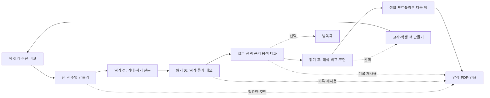

# PRD 14 온책읽기 전체 기능 구현 사전 브리핑

[전체 설계](../main.md) · [보고서 20종·PDF·인쇄 계약](15_report_templates_pdf_print.md)

작성일 2026-11-16 · 대상 초등 1~6학년 · 기술 기준 Next.js/Vercel + 독립 Firebase, Google 로그인 · 상태: 조사·구현 명세. 이 문서 전체가 구현 완료인 것은 아니다.

**구현 갱신:** 아래 2장의 감사 표는 확장 전 기준이다. 이후 다양한 책 등록·13권 추천·책갈피/보기 모드·20양식·실제 PDF·단계별 책 공방·IndexedDB/전체 백업을 로컬로 구현했다. 현재 실제 범위는 [학교 수업 매뉴얼](16_school_book_manual.md)과 [README](../README.md)를 우선한다. 학교 서버 운영·실시간 협업·학급 일괄 출력 등은 남아 있다.

## 1. 제품이 완성해야 할 일

교사가 학급에 맞는 책을 고르고, 수업 시간 안에 충분히 읽고, 학생이 자기 질문으로 이야기를 탐색하고, 대화·표현·저작을 거쳐 자기 생각을 돌아보도록 지원한다. 선정부터 수업 계획, 읽기 전·중·후 활동, 필요한 양식, PDF·인쇄, 관찰 기록, 다음 읽기까지 같은 수업 자료를 이어 쓴다.

온책읽기는 온전한 책·작품의 맥락을 경험하는 읽기 실천이다. ‘한 학기 한 권 읽기’와 겹치는 부분이 있지만, 슬로리딩·온작품 읽기·지속적 묵독 등을 모두 같은 말로 처리하면 운영 목적이 흐려진다. 과거 초등 연구도 이 차이와 학생의 도서 선택, 참여 방식, 교과 시간 안의 읽기, 문학·정보글 균형을 지적했다. [이경화, 2019](https://www.kci.go.kr/kciportal/landing/article.kci?arti_id=ART002548303), [온작품 읽기의 실천적 지식, 2021](https://www.kci.go.kr/kciportal/landing/article.kci?arti_id=ART002688161)

따라서 한 권을 무조건 한 학기 내내 늘여 읽게 하거나, 매 장면 퀴즈·독후감을 제출해야 다음 장으로 가는 구조를 만들지 않는다. 그림책·동화·장편·시·정보책을 모두 다루고, 학급 전체 같은 책·모둠별 책·개인 선택 읽기를 지원한다. 독후 활동 없는 읽기 차시도 유효하다. 국립어린이청소년도서관의 읽어주기 안내서도 활동이 책보다 중심이 되는 것을 경계한다. [책 읽어 주세요 안내서](https://www.nlcy.go.kr/attach/contents/file/%EC%B1%85%EC%9D%BD%EC%96%B4%EC%A3%BC%EC%84%B8%EC%9A%94%EC%95%88%EB%82%B4%EC%84%9C.pdf)

학생의 질문은 핵심 학습 기능이지만 **모든 읽기 뒤 질문 제출 의무**로 만들지 않는다. 수업 계획에 질문 탐구 차시를 넣고, 독립적으로 질문하고 근거를 찾는 경험을 쌓는다. AI는 선택한 질문의 탐색을 돕는 보조자다.

교육과정 연결은 **교육부 고시 2022-33호 일반 국어과 별책 5**를 기준으로 한다. 원문은 충분한 읽기 시간과 도서 선택, 종이·전자책 활용, 학생 질문과 사회적 읽기, 수업 중 관찰·대화에 기반한 평가를 다룬다. 3~4학년의 질문은 독후 정답 확인에 한정되지 않고 읽기 전·중 예측과 이해 점검을 포함한다. 관련 조항은 원문 인쇄 쪽수 21~22, 30, 60, 62~64쪽에서 확인했으며, 특수교육 국어과 고시와 혼용하지 않는다. [교육부 고시](https://www.moe.go.kr/boardCnts/viewRenew.do?boardID=141&boardSeq=93458&lev=0&search=), [국어과 원문—신라대학교 공식 재게시](https://koredu.silla.ac.kr/koredu/index.php?idx=3708&mode=fdn&num=1&pCode=SUB3400002)

## 2. 현재 구현과 실제 공백

| 영역 | 코드에서 확인된 현재 상태 | 이번 확장에 필요한 것 |
|---|---|---|
| 서재 | 전래 5·이솝 5·창작 3편, 검색·모음 필터 | 실제 도서 서지, 조건별 추천·비교·학생 선택, 외부 종이책 수업 |
| 읽기 | 고전 한영 50장면, 큰 글자, 장면 이동, 저장된 음성 | 장편 목차·읽기 범위, 북마크·메모·어휘·교사 함께 읽기 |
| 질문 | 자기 질문·생각 저장, 근거 장면 링크, 제한된 AI 힌트 | 질문 수정 이력·선정·탐색·다른 해석·성찰, 모둠 협의 |
| 수업 | 한 권 선택, 활동 연결 토글, 참여 표시 | 복수 수업 프로젝트, 전·중·후 차시 계획, 범위·일정·지원·배부 |
| 보고서 | 질문·완성본의 간단한 목록 | 단계별 작성 양식·포트폴리오·교사 관찰·운영 보고서 |
| 출력 | 고전 전권 인쇄 DOM과 `window.print()` | 실제 PDF 파일 생성, 빈 양식/작성본, 합본·개별·흑백·소책자 |
| 낭독극 | 준비된 대본·배역·성찰 | 판본 연결, 직접 각색, 장면·배역 편집, 결원·연습·대본 패킷 |
| 책 만들기 | 장면 편집·기존 삽화 선택·완성본 사본, AI 구성안 3개 | 실제 공동 편집·기여·충돌 처리·피드백, 교사 원고/삽화 생성과 검수 |
| 저장·계정 | 같은 탭의 sessionStorage, 미리보기 역할 | 영속 저장, 학교·학급별 서버 인가, Google 로그인, 권한 회수 |
| 운영 | 가상 명부·로컬 활동 집계 | 실제 관리자, 범위 제한 감사·권리·내보내기·비용·보존 관리 |

현재 10편은 짧은 어린이용 재서술 샘플이다. 이 샘플의 읽기·듣기 성공을 장편 한 권의 수 주 수업 운영 검증으로 대신할 수 없다. 일반 창작 리더의 인쇄도 현재 장면 범위이므로 전권 PDF 기능과 구별한다. [코드 감사 노트](research/wholebook-gap-audit-2026-11-16.md)

출력 확장 전에 확인할 코드 위험도 있다. 현재 전역 A4/A5 `@page` 규칙은 충돌 가능성이 있고, 질문 답변 저장과 revision 증가가 일치하지 않는다. 인쇄 크기는 출력 문서별로 격리하고, 수정된 응답은 새 revision으로 남겨 이전 보고서가 나중 답변으로 바뀌지 않도록 해야 한다. 이는 정적 코드 감사에서 발견한 보완 항목이며 실제 인쇄 오류 재현 결과와 구별한다.

## 3. 수업 흐름과 메뉴

화면상 여정은 길잡이이며 단계 잠금 장치가 아니다. 수업 없이 서재에서 읽기, 책 없이 질문, 독립 낭독극, 독립 창작도 가능하다. 나중에 활동을 수업에 연결하거나 해제해도 원본은 보존한다.

| 메뉴 | 맡을 기능 |
|---|---|
| 이야기 여정 | 오늘 할 일, 이어 읽기, 현재 수업 지도/목록, 여러 수업 전환 |
| 우리의 서재 | 탐색·추천·비교·선정, 종이책/디지털책/우리 책, 권리·매체 표시 |
| 질문과 탐구 | 내 질문·근거·탐구, 모둠 토의·토론, 출처 카드 |
| 낭독극 | 대본·배역·해석·연습·발표·성찰 |
| 책 만들기 | 교사 교재 제작과 학생 공동 창작의 서로 다른 작업 흐름 |
| 내 기록과 작품 | 읽기 수첩·보고서·포트폴리오·완성책·다운로드 |
| 교사: 수업 구성 | 추천부터 차시 계획·배부·지원·관찰·양식/출력센터 |
| 관리자: 운영 현황 | 학교·교사·학생·권한·콘텐츠·내보내기·감사·비용 |

양식 20종을 주 메뉴 20개로 늘리지 않는다. 관련 활동 화면의 ‘기록지’와 공통 출력센터가 같은 템플릿을 사용한다. 기존 사용자가 익숙한 이야기 지도·서가·몰입 리더는 각 작업에 맞게 유지한다.

## 4. 책 추천과 선정

책 추천은 학년만 고르는 기능으로 끝내지 않는다. 교사는 다음 조건을 기본값과 함께 수정한다.

- 학년/학년군, 학생 관심 주제, 독서 경험과 필요한 읽기 지원.
- 사용할 차시·차시 길이, 함께/모둠/개인 읽기, 교사 읽어주기 여부.
- 문학·정보책·시·그림책 등 갈래, 텍스트 분량·어휘·인물/사건 복잡성.
- 이미 읽은 책, 학생이 피하고 싶은 소재, 교사가 설명할 필요가 있는 장면.
- 실제 책 보유 권수·도서관 대출 가능 여부를 확인한 값, 구입 예산, 종이/웹/오디오 제공 조건.

첫 버전 추천은 검수된 서지와 설명 가능한 규칙으로 작동한다. 조건에 맞는 후보 3~5권, 추천 이유, 필요한 지원, 맞지 않을 수 있는 점을 나란히 보여준다. AI가 실재하지 않는 ISBN·쪽수·수상 이력·학교 보유량을 만들어 내지 못하게 한다. 데이터가 없으면 ‘확인 필요’로 남긴다. 추천 순위를 학생의 능력 등급으로 보여주지 않는다.

| ID | 기능·완료 기준 |
|---|---|
| REC-01 | 제목·저자·번역자·출판사·ISBN·출간/개정·쪽수·갈래·확인 출처·확인일을 판본별 보관한다. 출처 없는 수치는 자동 보충하지 않는다. |
| REC-02 | 추천 학년과 실제 읽기 지원을 분리한다. 출판사·공공기관 권장과 서비스의 제안을 구분해 표시한다. |
| REC-03 | 주제·수업 시간·매체·확보 조건으로 후보를 좁히고, 추천 이유 및 제외 사유를 설명한다. |
| REC-04 | 학생이 후보를 둘러보고 관심·선택 이유를 남긴다. 학급 투표 후에도 교사가 접근·지원 필요를 고려해 결정한다. |
| REC-05 | ‘앱에서 전문 읽기 가능 / 종이책으로 수업 / 허가된 외부 전자책 링크’를 구별한다. 추천 등록만으로 본문·표지를 수입하지 않는다. |
| REC-06 | 교사가 직접 종이책 서지와 판본을 등록해 수업을 만든다. 본문 파일이 없어도 쪽 참조·양식·토론은 사용할 수 있다. |
| REC-07 | 후보를 비교해 FORM-01로 내보내고 확정한 책·판본을 수업에 연결한다. 앱 내 재서술과 시판 책의 쪽수를 섞지 않는다. |
| REC-08 | 읽기 후 선택 이유·관심 변화·다음 책 희망을 추천에 반영하되 학생이 수정·삭제하고 다른 책을 선택할 수 있다. |

고전 10편을 계속 활용하되 실제 수업용 카탈로그에는 현대 그림책·동화·장편·비문학·시를 추가한다. **상업책 추천/종이책 수업 지원과 전문 열람 권리는 별개**다. 초기 실제 후보와 출처는 [도서·서비스 조사 노트](research/wholebook-books-services-2026-11-16.md)에 기록한다. 전국 공통 필독 목록이라고 표시하지 않는다.

### 초기 도서 후보와 추천 설명

아래 학년은 우리의 수업 설계 제안이다. 서지·판본·확인 출처는 조사 노트에 따로 기록했고, 모든 책을 완독하거나 수업 효과를 시험했다는 의미는 아니다. 혼자 읽기와 교사 낭독 지원을 구별하고 실제 학급의 관심·읽기 경험으로 조정한다. 어린이도서연구회도 초등 추천 연령을 스스로 읽는 기준으로 설명하면서 유연한 적용과 어린이의 선택을 권한다. [2026 목록 안내](https://www.childbook.org/news/notice_list.html?b_class=1&b_no=73&mode=VIEW_FORM&p=1)

| 수업 제안 | 후보 | 추천 화면에서 설명할 연결 |
|---|---|---|
| 1~2학년 | 수박 수영장, 알사탕, 틀려도 괜찮아 | 그림 단서·예상, 인물 마음, 교실에서 안전하게 말하기 |
| 3~4학년 | 만복이네 떡집, 책 먹는 여우 | 행동과 결과, 인물 변화, 읽기와 쓰기의 관계 |
| 4~6학년 | 기호 3번 안석뽕, 푸른 사자 와니니 | 선택·공동체·관점, 여러 장면을 연결한 근거 탐색 |
| 5~6학년 | 긴긴밤, 샬롯의 거미줄, 마당을 나온 암탉 | 관계·성장·상실·자유의 해석, 긴 서사 읽기 계획 |
| 보조책 | 아홉 살 마음 사전 | 감정 어휘 지원; 일부 항목 활용을 전권 완독으로 기록하지 않음 |
| 정보책, 1~2학년 중심 | 우리 몸의 구멍 | 관찰·궁금함·사실과 추측 구분; 출처를 확인하고 자기 신체 경험 공개는 강요하지 않음 |
| 동시집, 3~4학년 중심 | 감자꽃 | 소리·장면·표현 감상과 여러 해석; 시 몇 편을 읽은 것을 시집 전권 완독으로 표시하지 않음 |

총 13권의 후보를 기록했다. 정보책은 [길벗어린이 공식 소개](https://gilbutkid.co.kr/216993336/?idx=618), 동시집은 [국립중앙도서관 정보나루의 특정 판본 서지](https://data4library.kr/bookV?seq=2368083)를 확인했다. 정보책·시집에는 서사 전용 인물/사건 양식을 자동 배정하지 않는다.

예를 들어 『알사탕』 2024 개정판과 이전 판본은 출판사·쪽 참조를 섞지 않는다. 『책 먹는 여우』도 확인된 2026 기념판과 다른 판본을 구분한다. 현대 책의 본문·표지·음성은 서지 등록만으로 제공하지 않으며, 학생이 실제 종이책을 준비한 상태에서 기록지·질문·토의·PDF를 사용하도록 한다.

### 기존 서비스에서 확인한 점

| 서비스 | 공식 공개자료에서 확인한 방향 | 이 제품에 반영할 점 |
|---|---|---|
| 독서로 | 학교도서관 정보, 독후활동 지도·기록 지원 | 도서 확보와 기록 연결; 외부 시스템 연동이 구현됐다고 표시하지 않음 |
| 두클래스 온북 | 학년·키워드 탐색, 전자책·오디오북 메뉴 | 선정부터 매체 선택까지 이어지는 탐색; 개별 책의 권한·자료 제공 여부 표시 |
| Book Creator | 공동 책 제작, 낭독, 교사 피드백, PDF·인쇄 | 학생 저작과 독서 연결; PDF에는 음성·영상이 포함되지 않으므로 웹 판본과 별도로 제공 |
| ReadingGate | 음성이 있는 eBook과 원서 미제공 pBook Quiz 구분, 학습 기록 | 전문 제공 여부를 분명히 표시; 영어 학습 점수 체계를 문학 해석 평가로 그대로 옮기지 않음 |

근거: [독서로 소개](https://read365.edunet.net/SystemInfo), [온북](https://onbook.douclass.com/main), [Book Creator 기능](https://bookcreator.com/features/)·[PDF 안내](https://intercom.help/bookcreator/en/articles/2398647-export-your-book-as-a-pdf-file), [ReadingGate FAQ](https://util.readinggate.com/Support/SupportFAQ). 공개 소개 확인과 로그인 내부 검증을 구분한다. 다른 서비스에 기능이 없다고 단정하지 않으며, 우리 제품의 집중점은 **책 선정부터 자기 질문·대화·선택적 표현·기록 재사용까지 이어지는 교사 수업 흐름**이다.

## 5. 학년별 경험

아래는 고정 발달 진단이나 공식 필독 수준이 아닌 기본 화면·수업 지원 제안이다.

| 학년 | 시작 경험 | 선택 지원 | 기록·표현의 예 |
|---|---|---|---|
| 1 | 그림책 함께 보기·교사 읽어주기·반복 말 즐기기 | 그림/큰 글자/말로 질문/교사 받아쓰기 | 궁금한 장면 그리기·한마디; 읽기만으로 마침 가능 |
| 2 | 짧은 이야기 전체 흐름·인물 행동 따라가기 | 짝 읽기·낱말 도움·짧은 역할 읽기 | 장면 순서·인물에게 묻고 싶은 말 |
| 3 | 여러 장면 연결·자기 질문 고르기 | 장면 북마크·질문 시작 틀을 요청 시 제공 | 질문–본문 단서–내 생각 |
| 4 | 인물 마음 변화·원인/결과·대화로 생각 수정 | 관계도·모둠 역할·여러 장면 비교 | 다른 해석과 수정 이유·짧은 서평 |
| 5 | 긴 서사·작품 관점·주제 탐색·정보책 비교 | 차시 분량 조절·어휘·출처 카드 | 토론 논거·서평·각색·공동책 |
| 6 | 관점과 표현의 효과·자료의 신뢰성·작품 간 비교 | 복수 자료·비판 질문·자율 계획 | 근거 묶기·반론·독자 고려 글쓰기·성찰 |

어느 학년이든 듣기, 큰 글자, 짝 읽기, 쉬운 어휘 설명을 선택할 수 있다. 듣기는 같은 이야기 대화에 참여하는 경로지만 문자 해독 능력을 자동 증명하지 않는다. 기기 사용·타자 능력이 작품 이해의 평가 점수를 결정하지 않도록 한다.

## 6. 단계별 상세 기능

### 6.1 수업 준비·차시 운영

| ID | 기능·완료 기준 |
|---|---|
| PLAN-01 | 학급·책·목표·기간·차시·참여 매체를 받아 수업 초안을 만든다. 기존 학급 값은 다시 입력하지 않는다. |
| PLAN-02 | 짧은 작품/그림책과 장편용 차시 예시를 제공하고, 교사가 차시 추가·합치기·순서 변경·연기한다. 고정 차시 수를 교육 효과로 주장하지 않는다. |
| PLAN-03 | 차시마다 읽기 범위·실제 읽을 시간·핵심 활동·준비물·관찰 초점을 둔다. 모든 차시에 제출물을 자동 생성하지 않는다. |
| PLAN-04 | 교육과정 연결은 원문을 확인한 고시/버전·학년군·성취기준 코드에 한정한다. AI 추정 연결은 교사 검토 전 제안 상태다. |
| PLAN-05 | 같은 책 전체 읽기·모둠별 선택·개인 선택을 지원하며 활동 템플릿을 공유할 수 있다. |
| PLAN-06 | 선택한 활동만 웹 배부·인쇄 꾸러미로 만들고, 기본은 교사용 흐름표+필요한 학생 양식이다. |
| PLAN-07 | 결석·읽는 속도 차이·기기 없음·종이 참여 학생의 다음 참여 지점을 표시한다. 전원 디지털 미제출을 결손으로 자동 처리하지 않는다. |
| PLAN-08 | 이전 수업의 책·양식·일정 구조를 복제하되 학생 응답·명부·평가·공유 권한은 새 수업으로 복제하지 않는다. |

#### 중학년 40분 × 8차시 구성 예시

아래는 교사가 고쳐 쓰는 예시이며 모든 책에 맞는 표준 차시 수가 아니다. 실제 책의 길이와 학생 지원 필요를 보고 읽기 차시를 늘리거나 줄인다. 짧은 재서술 샘플 한 편을 억지로 8차시에 늘이지 않는다. 장·쪽 범위는 교사가 확인한 판본으로 설정한다.

| 차시 | 40분의 예시 배분 | 선택 기록·출력 |
|---|---|---|
| 1 선정·첫 만남 | 후보 살피기 10분, 허용된 미리보기/종이책 함께 읽기 20분, 선택·계획 10분 | FORM-01, 원하면 FORM-03 |
| 2 작품에 들어가기 | 시작 안내 5분, 읽기/교사 읽어주기 30분, 마무리 5분 | 기록 없이 종료 가능 |
| 3 궁금함 발견 | 읽기 25분, 자기 질문 만들기·고르기 10분, 마무리 5분 | FORM-08 원래 질문 |
| 4 다시 읽고 살피기 | 읽기 25분, 선택한 질문의 단서 찾기 10분, 마무리 5분 | FORM-09 질문·근거 |
| 5 끝까지 읽기 | 남은 부분 읽기 20분, 짝과 생각 나눔 15분, 마무리 5분 | FORM-04/11 중 필요한 것; 못 읽은 분량은 다음 차시 확보 |
| 6 서로 다른 생각 | 필요한 부분 다시 읽기 10분, 질문 중심 모둠 대화 30분 | FORM-10, 기존 질문에 생각 변화 추가 |
| 7 선택 표현 | 서평·그림·짧은 낭독극·재창작 중 하나 30분, 다시 읽기·수정 10분 | 선택 활동의 FORM-13/14/16; 전체책 제작은 추가 차시 |
| 8 돌아보기·다음 읽기 | 성찰 10분, 남길 기록 선택 10분, 다음 책 살피고 읽기 20분 | FORM-19 자동 조립, 교사는 FORM-20 선택 |

읽기 시간이 부족하면 표현 활동을 축소·연기하고 읽을 시간을 먼저 확보한다. 교사는 수업 계획에서 필요한 양식만 고르며, 이 표에 보이는 양식 전부를 학생에게 배부하지 않는다.

### 6.2 읽기 전·중·후의 리더와 수첩

| ID | 기능·완료 기준 |
|---|---|
| READ-01 | 표지·제목·목차 살피기, 알고 있는 것, 예상과 이유, 개인 읽기 목표를 선택 활동으로 제공한다. |
| READ-02 | 책/장/장면/문단의 안정된 ID와 판본을 사용한다. 장편 목차·읽은 위치·차시 범위가 이어진다. |
| READ-03 | 글자 크기·줄 간격·문단 폭·밝기 테마·키보드 조작을 지원한다. 몰입 중 장식과 문제 팝업을 최소화한다. |
| READ-04 | 북마크·궁금함 표시·개인 메모·어휘 카드가 질문/보고서로 연결되며 원문 위치를 잃지 않는다. |
| READ-05 | 낱말은 문맥에서 먼저 짐작하고 뜻·출처를 확인하는 흐름이다. 모든 단어에 자동 설명을 띄우지 않는다. |
| READ-06 | 저장된 음성 재생·정지·속도·탐색·구간 반복을 제공한다. 장면 동기화는 시간표가 검수된 판본에만 표시한다. |
| READ-07 | 교사 한 화면의 함께 읽기 모드, 학생 화면에 교사 메모 숨김, 글자 확대·장면 선택을 제공한다. 개인 로그인 없이 종이 수업 운영 가능. |
| READ-08 | 읽기 후 인물·사건·주제·기억할 근거·달라진 생각을 선택해 정리한다. 정보책은 질문·정보·출처 비교 템플릿을 사용한다. |

### 6.3 학생이 질문하는 힘

| ID | 기능·완료 기준 |
|---|---|
| ASK-01 | 학생 질문을 자기 말·그림·구술 기록으로 먼저 남긴다. AI 예시를 처음부터 정답처럼 노출하지 않는다. |
| ASK-02 | 사실 확인·추론·해석/통합·비판/평가·새롭게 상상하기를 도움용 분류로 제공한다. ‘왜’라는 단어만으로 추론이라고 판정하지 않는다. |
| ASK-03 | 열린/닫힌 질문은 별도 축이다. 분류 없음·미완성 질문을 저장하고, 닫힌 질문을 낮은 점수로 취급하지 않는다. |
| ASK-04 | 원래 질문·수정 질문·바꾼/유지한 이유·도움 이력을 보존한다. AI가 질문을 덮어쓰지 않는다. |
| ASK-05 | 개인/모둠에서 탐구할 질문을 고르고 선정 이유·탐색 방법을 남긴다. 질문 수 순위를 만들지 않는다. |
| ASK-06 | 본문 다시 읽기·여러 장면 비교·친구와 대화·추가 자료 찾기 중 탐색 경로를 선택한다. |
| ASK-07 | 나의 잠정 생각–근거–다른 해석–현재 생각–남은 질문을 기록하고 FORM-08/09로 묶는다. 미해결 질문도 정상 종료 가능하다. |
| ASK-08 | AI 도움은 선택적 힌트·근거 찾기·검토할 후속 질문이다. 학생 최종 답·성취 판정을 자동 작성하지 않으며, 꺼져 있어도 흐름이 완결된다. |

질문 생성·개선·선택·활용·성찰을 이어 보게 하는 점은 질문 교육 자료와 맞닿아 있다. RQI 자료는 방법 참고로만 사용하며 상업 이용 허락 조건이 있으므로 원문 양식을 서비스에 복제하지 않는다. 위 ASK 요구사항은 독자적인 제품 설계다. [RQI 안내와 이용 조건](https://rightquestion.org/what-is-the-qft/)

### 6.4 토의·토론·탐구

| ID | 기능·완료 기준 |
|---|---|
| TALK-01 | 짝/모둠/학급 대화에 학생이 고른 질문을 연결한다. 교사는 대화 초점과 공개 범위를 정한다. |
| TALK-02 | 인물 선택·주제·가치에 관한 여러 해석을 나란히 두고 각자의 근거 위치를 연결한다. |
| TALK-03 | 말하기·듣기·기록·질문 정리 역할을 선택·순환한다. 발언량으로 참여 점수를 자동 매기지 않는다. |
| TALK-04 | ‘동의+이유/다른 생각+근거/다시 묻기’ 도움말, 보류·다름을 남길 공간을 제공한다. |
| TALK-05 | 모둠의 합의와 남은 차이를 함께 기록하고 개인 질문으로 다시 가져갈 수 있다. 교사 승인 없이 외부 공개하지 않는다. |
| TALK-06 | 자료 탐구는 제목·발행 주체·날짜·URL·찾은 정보·확실하지 않은 점을 적는 출처 카드를 제공한다. 외부 웹 검색 AI는 별도 기능/비용 범위다. |

### 6.5 표현·낭독극·저작

| ID | 기능·완료 기준 |
|---|---|
| MAKE-01 | 서평·편지·책 소개·인물 인터뷰·다른 결말·신문·그림 등에서 교사가 고른 표현 활동만 제공한다. 원작 이해 근거와 창작 부분을 구분한다. |
| MAKE-02 | 낭독극 대본에 원작 판본·장면을 연결하고, 대사/해설/무대 지시를 편집한다. 각색 권리 확인 전 배포하지 않는다. |
| MAKE-03 | 배역별 보기·강조·인쇄, 공동 해설·역할 합치기·결원 대안을 제공한다. 외워서 공연하거나 전원 녹음하는 것을 필수로 하지 않는다. |
| MAKE-04 | 인물 의도와 읽는 방법의 근거, 연습 뒤 바꾼 부분을 기록한다. 자동 발음 점수·감정 판정은 기본 기능에서 제외한다. |
| MAKE-05 | 교사 제작은 지역·주제·학년·유형→구성안→선택→전체 원고→그림→검토→판본 확정 순으로 이어진다. 지역 사실과 허구를 구분한다. |
| MAKE-06 | 원고/특정 페이지/그림만 다시 만들 수 있고 나머지 작업은 유지한다. 생성 전 예상 범위·비용을 표시하고 승인 한도를 검사한다. |
| MAKE-07 | 학생 창작은 공동 구상·초고·동료 피드백·수정·기여·완성본을 남긴다. AI가 전편을 대신 만들어 학생 저작으로 표시하지 않는다. |
| MAKE-08 | 동시 편집에서 버전 충돌을 표시하고 사본·수정 이력으로 복구한다. 역할 분담 목록을 실제 기여의 증거로 오인하지 않는다. |
| MAKE-09 | 완성책은 초안과 분리된 판본으로 저장하며, 서재·웹 읽기·허용된 PDF·낭독으로 연결한다. 공개 범위를 학급/학교/외부로 나눠 별도 승인한다. |

### 6.6 기록·평가·재사용

| ID | 기능·완료 기준 |
|---|---|
| RECORD-01 | 20종 템플릿에서 학년군·학생/모둠/교사·빈 양식/작성본을 선택한다. 모든 양식은 직접 편집 가능하다. |
| RECORD-02 | 북마크·질문·근거·생각·초안 기록을 학생이 골라 포트폴리오로 가져온다. 다시 입력하지 않는다. |
| RECORD-03 | 교사는 질문·근거 연결·다른 생각 듣기·표현 수정 중 관찰 초점을 고르고, 관찰 사실과 다음 지원을 기록한다. |
| RECORD-04 | 자기 점검·동료 피드백·교사 관찰을 분리한다. ‘관찰하지 않음’과 ‘어려움이 관찰됨’을 같은 값으로 처리하지 않는다. |
| RECORD-05 | 학급 보고서는 계획 대비 실행·지원·사례·교사의 개선점을 중심으로 만들고 학생 서열표를 기본 제공하지 않는다. |
| RECORD-06 | PDF 출력본을 고정 스냅샷으로 만들고 판본·대상·생성일을 기록한다. 20종 필드와 EXP-01~18은 [PRD 15](15_report_templates_pdf_print.md)를 따른다. |

## 7. 교사 일이 늘지 않게 만드는 기본값

1. 수업 준비에서 학급의 언어·학년·기기 조건은 자동 불러오고, 책·목표·시간·매체만 주로 고친다.
2. 권장 꾸러미는 읽기 중심 최소 묶음으로 시작한다. 활동·양식·관찰 초점은 추가 선택이다.
3. 같은 내용을 수업 계획·웹 활동·인쇄 양식·보고서에서 재입력하지 않는다.
4. 교사가 모든 질문에 답하거나 전원 채점해야 다음 차시로 가는 조건을 두지 않는다.
5. 종이·구술 참여는 일괄 표시할 수 있고 사진/OCR 전원 업로드를 요구하지 않는다.
6. 다음 학기 수업 복제 때 학생 데이터는 비우고 교사가 만든 수업 구조만 재사용한다.
7. AI 결과가 길고 과도해 검수 부담을 늘리지 않도록 필요한 부분만 생성·비교·채택한다.
8. 교사의 총 소요시간은 선정·준비·배부·수업 중 기기 대응·검수·정리까지 측정한다. 클릭 수나 생성 자료 수만으로 업무 절감을 주장하지 않는다.

이 항목들은 검증할 제품 설계다. 아직 실제 학급에서 시간 절감이나 학력 향상을 입증한 결과가 아니다.

## 8. 데이터·저장·권한 구조

기존 모델을 무리하게 한 객체로 늘리지 않고 다음 기록을 분리한다. 아래 이름은 도메인을 설명하는 논리 명칭이며, [PRD 08](08_platform_architecture.md)의 공통 저장 모델과 같은 개념의 원장을 중복 생성하지 않는다. 독립 활동은 수업 연결 없이 존재한다.

| 모델 | 주요 필드·역할 |
|---|---|
| `BookRecord` | 서지·갈래·추천 근거·출처·확인일; 외부 종이책도 등록 |
| `EditionRevision` | 특정 번역/개작/출판본·장면/문단·해시·권리·매체 가능 여부 |
| `ReadingProject` | 학급·책 판본·목표·기간·참여 방식·상태 |
| `LessonSession` | 차시·날짜·범위·읽기 시간·활동·지원·관찰 초점 |
| `ActivityDefinition` | 활동 종류·기본 단계·템플릿 revision; 배정·수업 배치와 분리 |
| `ActivityResponse` | 학생/모둠·입력·응답 방식·근거·수정·공유 이력 |
| `QuestionThread` | 질문 원문/개정·선정 이유·근거·다른 해석·현재 생각·남은 의문 |
| `Observation` | 교사가 실제 관찰한 사실·지원·다음 계획; 활동량과 구별 |
| `TemplateRevision`, `ExportSnapshot` | 양식 버전과 출력에 사용한 정확한 내용·판본·대상 |
| `CreativeProjectRevision` | 교사/학생 제작 구분·페이지·기여·피드백·검토·공개 범위 |
| `Membership`, `AuditEvent` | 학교/학급/역할/회수 상태, 주요 변경·내보내기 추적 |

### 기존 저장 모델과의 매핑

| 논리 명칭 | PRD 08의 공통 모델·제약 |
|---|---|
| `BookRecord`, `EditionRevision` | `works`·`editions`의 서지 조회 모델과 `edition_revisions`. 외부 종이책도 같은 판본 원장에 매체 유형으로 등록하며 본문은 없어도 됨 |
| `ReadingProject`, `LessonSession` | `reading_units`와 `lesson_sessions`. 화면의 journey ID는 reading unit ID와 동일; 계획 버전은 `journey_plan_revisions` |
| 활동 정의·실행·수업 연결 | 재사용 정의/템플릿, `activity_instances`, `journey_activity_bindings`를 분리. 필수/선택·공개 시점·수행 판단은 binding revision에, 실제 참여자는 `activity_participants`에 둠 |
| `ActivityResponse`, `QuestionThread` | 모듈의 원본 기록을 참조하는 공통 조회 계약. 질문은 `student_questions`·`question_revisions`·`question_selections`·`evidence_links`·`inquiry_responses`·`question_reflections`를 재사용. 기존 기록이 없는 일반 양식 응답만 새 응답 엔터티로 저장 |
| `Observation` | 읽기·질문·낭독·저작별 기존 관찰 엔터티. 보고서에서 별도 중복 평가 원장을 만들지 않음 |
| `CreativeProjectRevision` | `story_projects`와 페이지·기여·검토 revision을 묶은 조회 모델 |
| `TemplateRevision`, `ExportSnapshot` | 신규 `report_template_revisions`, `report_snapshots`; 기존 `export_jobs`가 고정 스냅샷을 렌더링하고 결과 파일은 `assets`로 연결 |
| `Membership`, `AuditEvent` | `school_memberships`·`class_memberships` 등 기존 조직 소속과 `audit_events` |

앱 안의 장면 ID와 시판 종이책 쪽 번호를 동일 값으로 쓰지 않는다. 디지털 근거는 `edition_revision_id + text_block_id/scene_id`, 종이 근거는 외부 종이책 유형의 `edition_revision_id + pageRange`를 참조한다. 종이책의 서지 개정도 불변 revision으로 남긴다. 공유 활동의 책 교체는 새 activity instance와 해당 binding의 새 revision으로 처리하고, 옛 질문·응답·완료 상태는 이전 활동에 남긴다. 새 활동에 완료 상태를 자동 승계하지 않는다.

수업 상태는 `draft → ready → running → reflected → archived`, 응답은 `draft → shared → revised` 등을 사용한다. 이 상태는 독서 이해도나 자동 성취 판정이 아니다. 실제 저장 실패를 저장 성공으로 숨기지 않는다.

### 운영 필수 요구사항

| ID | 기능·완료 기준 |
|---|---|
| OPS-01 | Google 로그인과 학교·학급 소속을 서버에서 확인한다. 교사/관리자 권한은 클라이언트 선택값으로 부여하지 않는다. |
| OPS-02 | 계정이 어려운 저학년은 교사 화면+종이로 참여하고, 디지털 개별 참여는 교사 관리 신원/수업 참여 방식과 승인 조건을 별도로 설계한다. 공유 Google 계정을 만들지 않는다. |
| OPS-03 | 문서·미디어·PDF 다운로드·실시간 구독에 같은 학교/학급 접근 범위를 적용한다. Admin SDK 경로에도 서버 인가를 둔다. |
| OPS-04 | 사용자별 비공개, 모둠/학급 공유, 외부 공개를 구분하고 회수·삭제·학급 종료 흐름을 제공한다. |
| OPS-05 | 감사에는 사건 종류·행위자·대상 ID·시간·결과·판본을 남기고 학생 원문·음성·키를 일반 로그에 복제하지 않는다. |
| OPS-06 | AI·파일·내보내기는 범위·기간·횟수·비용 한도를 확인한다. 별도 과금은 기존 승인과 다른 범위로 몰래 확장하지 않는다. |
| OPS-07 | 한국어/영어 UI와 라이트/다크를 유지한다. UI 언어와 책 판본 언어를 분리하고 새 언어 콘텐츠는 검수 상태를 표시한다. |
| OPS-08 | homework는 독립 링크/내보내기 어댑터부터 시작하고 기존 코드·DB·인증·버킷·배포에 쓰지 않는다. 읽기 서비스 장애가 homework로 전파되지 않게 한다. |

학생은 자신의 비공개 기록, 교사는 담당 범위, 관리자는 승인된 운영 목적에 필요한 범위만 조회한다. 학교 소속이나 관리자 역할만으로 모든 학생의 원문을 일괄 열람하는 권한을 부여하지 않는다. 운영 단계의 출력·다운로드는 원본별 권한과 최신 회수 상태를 다시 검사하며 익명화 여부가 권한 검사를 대신하지 않는다.

저장 구현은 `Repository` 경계로 분리한다. 초기 로컬 단계에서는 샘플 데이터의 지속 저장·백업/복원부터 검증하고 민감 실데이터는 사용하지 않는다. 운영 단계에서는 읽기 전용으로 검토한 Firebase 프로젝트 범위·요금·리전·보존 정책과 승인을 확인한 뒤 Auth/Firestore/Storage를 연결한다. 오프라인 대기·동기화·충돌·실패 상태를 구분한다.

현재 sessionStorage 샘플을 옮길 때는 schema version을 검사하고 이전 질문·초안·고정본의 ID를 매핑해 보존한다. 변환 실패 시 원본을 지우거나 빈 상태로 덮어쓰지 않으며, 백업 내보내기와 복구 선택을 제공한다. 기존 샘플 역할은 실제 사용자 계정으로 자동 승격하지 않는다.

## 9. 구현 단위와 완료 판정

‘모든 기능’을 한 번에 화면만 추가한 것으로 완료하지 않는다. 아래 순서로 실제 사용 가능한 묶음을 완성하고, 각 묶음의 산출물·테스트 결과를 기록한다. WB-L은 이번 확장의 로컬 개발 범위, WB-O는 운영 연결 범위다. main의 기존 출시 우선순위 P0~P2와 별개의 작업 묶음이며, 기능을 삭제하는 구분이 아니다.

| 묶음 | 실제 산출물 | 완료 조건 |
|---|---|---|
| WB-L1 책 선정·수업 설계 | 검수 서지·추천/비교, 외부 종이책, 복수 수업·차시·활동 모델, 지속 저장 어댑터 | 책 3권 비교→선정→8차시 예시 수정→수업 재개; AI 없이 실행 |
| WB-L2 단계별 수첩·질문 | 북마크·어휘·인물/사건·질문 수정/탐색·토의·읽기 후 양식 | 자기 질문→근거→다른 생각→성찰; 종이/구술도 정상 참여 |
| WB-L3 보고서·PDF·인쇄 | 20종 템플릿, 빈/작성본 PDF, 개별/합본, A4/A5·흑백·큰 글자 | 실제 PDF 다운로드·한글·긴 글·쪽수·교사 메모 분리·인쇄 미리보기 통과 |
| WB-L4 표현·저작 통합 | 판본 연결 낭독극, 교사 전체책 제작 흐름, 학생 기여·피드백·완성본 | 질문/책→각색/창작→검토→새 판본→서재/PDF; 원본 보존 |
| WB-O1 학교 운영 | Google/Firebase, 서버 인가, 학교·학급·교사·학생 관리, 내보내기 권한 | 다른 학교·다른 학생 접근 차단, 권한 회수, 실제 저장·복원, 로컬/운영 분리 |
| WB-O2 협업·운영 안정화 | 실시간 충돌 처리, 감사/보존/비용, 검수 음성·출판, homework 독립 어댑터 | 동시 수정 복구, 판본 일치, 요청 중복/비용 상한, 기존 homework 변경 없음 |

교사 원고·삽화·음성의 새 유료 생성, 클라우드 읽기/쓰기·파일 저장/전송·호스팅·배포는 과거 샘플 검증 승인에 포함하지 않는다. 개발 가능한 로컬 기능과 고정 샘플·모의 실패 검증을 먼저 진행하고 실제 과금 실행 직전에 구체적 비용 범위를 설명한다.

### 반드시 통과할 실제 시나리오

1. 1학년: 교사 한 화면과 종이만으로 그림책 읽어주기, 원하면 그림/구술 질문, 큰 글자 빈 양식 PDF. 읽기만으로 수업 종료 가능.
2. 3학년: 추천 후보 비교→학생 선택 이유→수업 계획→자기 질문→본문 근거→다른 생각→개인 보고서 PDF. 학생 질문 원문 보존.
3. 6학년: 시판 장편 종이책 서지만 등록→쪽수로 읽기 계획→토론/자료 출처→서평→포트폴리오. 미허가 전문 다운로드 없음.
4. 모둠: 역할 바꾸기→공동 초고→피드백→동시 수정 충돌 처리→완성책 판본. 교사의 대리 입력과 학생 실제 기여 구별.
5. 교사: 학급 합본 출력에서 특정 학생 제외·익명 처리·교사 메모 분리, 긴 글 누락 없음, 선택 쪽 재출력.
6. 장애: AI 꺼짐·인터넷 끊김·PDF 생성 실패·권한 회수에도 원문 유지, 실패 상태 표시, 자동 유료 우회 없음.
7. 시스템: 새 학기 수업 복제에 과거 학생 데이터 섞임 없음, 학교 간 격리, homework 파일·데이터 변경 없음.

## 10. 조사 자료와 미확인 사항

공식 교육과정·교육청/공공도서관 자료, 교사의 공개 수업 사례, 학술 연구, 서비스 공식 소개를 나누어 확인했다. 공개 소개에 나온 기능과 로그인 내부 실사용 검증은 다르다. 이번에는 실제 학교 인터뷰·학급 파일럿·유료 서비스 내부 검증을 하지 않았다.

- [교육·교사 요구 조사](research/wholebook-pedagogy-2026-11-16.md): 정의, 읽기 전중후, 전학년 지원, 공식 자료의 실제 확인 범위.
- [도서·서비스 조사](research/wholebook-books-services-2026-11-16.md): 실제 추천 후보, 출처, 비교 서비스 공개 기능과 권리 구분.
- [현재 코드 감사](research/wholebook-gap-audit-2026-11-16.md): 구현·부분구현·미구현과 파일 근거.
- [보고서·출력 상세 계약](15_report_templates_pdf_print.md): 20종 필드, 학년군 변형, PDF·인쇄 검증.

추가로 확인할 운영 항목은 학교 계정 도입 방식·동의/보존 기간·실제 도서 보유·프린터·클라우드 청구 조건·교사 검수 참여자다. 이 항목들이 정해지지 않았더라도 로컬 수업 모델·양식·PDF·샘플 흐름의 구현은 진행할 수 있다.
