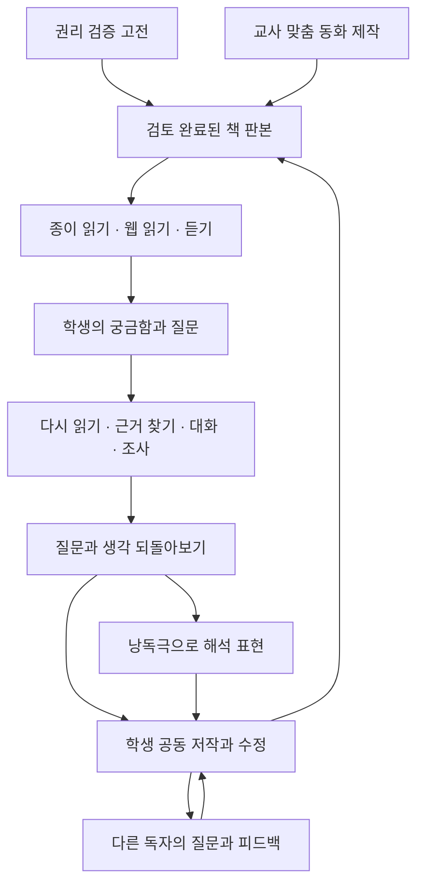
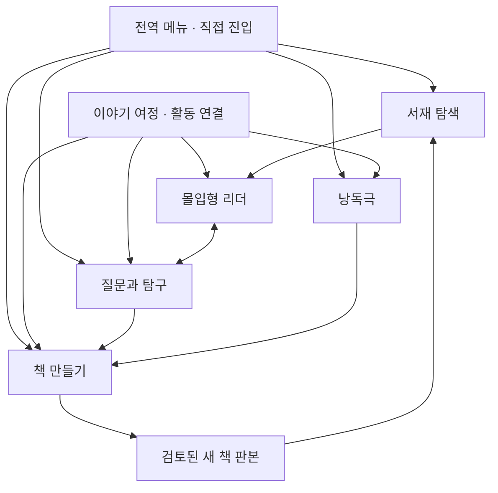

# 초등 독서 기반 읽기 질문 낭독 공동 저작 플랫폼 설계

작성일: 2026-11-16 · 대상: 초등학교 1~6학년 · 상태: PRD v1.5 / 책 워크플로·랜딩·Google 인증·체험 분리 구현 · 운영 구조: GitHub jejuailabs/reading → Vercel + Firebase

이 제품은 한 작품을 종이책·웹·오디오로 접하고, 학생이 스스로 질문을 만들고 탐색하며, 낭독극과 공동 창작으로 해석을 확장하는 수업을 지원한다. 교사는 검증된 작품을 고르거나 지역·주제에 맞는 동화책을 제작한다. 아이들이 만든 책도 같은 읽기 환경으로 돌아와 다음 독자의 질문을 받는다.

성공 기준은 책·문제·AI 생성량이 아니라 **학생의 읽기 경험과 질문·표현의 자립성, 교사의 총 운영시간 감소**다. 모든 책에 모든 활동을 강제하지 않는다.

현재 소스에는 여정·샘플 서재·리더·자기 질문·고정 대본에 더해, 원고/텍스트 PDF/그림/종이책/온라인 링크 등록, 13권 추천, 보기·읽기·책갈피, 20양식 기록장, 빈/작성본 PDF와 전권 PDF, 교사·개인·팀의 단계별 책 공방, IndexedDB 보관·전체 백업·복원을 구현했다. 전래 5편·이솝 5편의 한영 재서술과 저장된 음성도 제공한다. 이번 변경에는 설명형 랜딩, 최상단·최하단 Google 로그인, 서버 세션·역할 검사, `/demo` 체험과 `/app` 계정 작업의 분리가 추가됐다. AI 질문·문항 코칭과 교사 구성안은 기존 승인 한도 안의 개발용 연결이며, 운영 AI와 이미지 API는 비활성이다. 디자인용 생성은 사용자 지시에 따라 구독 내장 imagegen만 사용한다. 학교·학급 소속 관리·Firestore/Storage 업무 데이터 저장·실시간 협업·학급 합본은 아직 미구현이다.

이번 소스는 **106개 테스트와 프로덕션 빌드를 통과**했다. 로컬에서 실제 `accounts.google.com` 로그인 페이지까지 연결을 확인했으며, 자격증명 입력 이후의 실제 계정 로그인 완료는 검증하지 않았다. **현재 공개 배포는 이전 앱 소스 `6aa8393`이고 이번 업데이트 배포는 비용 범위 승인 대기 중**이다. 실제 범위는 [README](README.md), 로그인과 체험은 [새 안내](docs/18-auth-landing-demo.md), 개별 수업 흐름은 [학교 수업 매뉴얼](docs/16_school_book_manual.md)과 [책 공방 매뉴얼](docs/manual-bookmaking.md), 기존 배포 이력은 [GitHub/Vercel 기록](docs/17_github_vercel_release.md)을 기준으로 확인한다.

## 1. 확정된 요구사항

| 영역 | 설계 결정 | 상세 문서 |
|---|---|---|
| 대상 | 초등 전 학년, 1~2·3~4·5~6학년별 지원 차등 | PRD 02 |
| 교육 중심 | 읽기와 학생이 직접 질문하는 힘, 근거 탐색, 해석과 표현 | PRD 02 |
| 콘텐츠 | 권리가 확인된 고전, 교사 제작 동화, 학생 공동 저작 | PRD 03·05·06 |
| 매체 | 인쇄 소책자, 온라인 읽기, 듣기, 함께 읽기 | PRD 03 |
| 책 선정·수업 | 추천 이유·판본·확보 조건, 학생 선택, 전·중·후 차시와 읽기 시간 확보 | PRD 14 |
| 보고서·출력 | 선택형 양식 20종, 기록 재사용, 빈/작성본 PDF, A4/A5·합본·인쇄 | PRD 15 |
| 활동 | 질문·토론·낭독극·창작·동료 피드백·고쳐 쓰기 | PRD 02·04·06 |
| 교사 저작 | 지역·주제·학년·유형 → 줄거리 제안 → 선택 → 글·삽화·책 제작 | PRD 05 |
| 학생 저작 | 학급 공동책, 모둠책, 개별 작품 합본; 사람의 기여 보존 | PRD 06 |
| 화면 구조 | 설명형 랜딩 + 체험 교실 + 로그인한 이야기 여정 + 기능별 작업·역할별 관리 화면 | PRD 08·구현 기록 18 |
| 독립·연계 사용 | 서재·질문·낭독·저작에 직접 진입, 기존 활동을 선택적으로 여정에 연결 | PRD 02~06·08 |
| 인프라 | reading 독립 Vercel과 Firebase 인증; 현재 업무 데이터는 계정별 기기 저장, Firestore/Storage는 후속 범위 | PRD 08·구현 기록 18 |
| 인증 | Firebase Google 인증·HttpOnly 서버 세션·앱 전용 reading_role 검사 구현; 실제 계정 로그인 완료 검증과 운영 업데이트는 남아 있음 | PRD 07·구현 기록 18 |
| 학생 접근 | Google 계정이 어려운 경우 교사 관리 개별 참여; 공유 계정 금지 | PRD 07 |
| 국제화 | 한국어·영어 UI 우선, 언어 확장 구조; UI 언어와 책 언어 분리 | PRD 08 |
| 테마 | 라이트·다크 토글, 시스템 설정 선택, 사용자 선택 유지 | PRD 08 |
| 관리자 | 학교·교사·학생·학급·권한·콘텐츠·비용·감사·운영 대시보드 | PRD 07·09 |
| 로그 | 전체 주요 업무 흐름 추적, 권한별 조회, 민감 원문 최소 수집 | PRD 09 |
| homework | 기존 프로젝트를 변경하지 않는 독립 어댑터, 기본 비활성 | PRD 10 |
| 비용 | 별도 과금 전 서비스·목적·기준·한도·기간·갱신 조건을 설명하고 명시 승인 | PRD 08·09·10 |

## 2. PRD 읽기 순서

1. [PRD 01 제품 전략과 조사 근거](docs/01_product_research.md): 교사의 문제, 경쟁 서비스, 검증 가설, 성공 지표.
2. [PRD 02 읽기 수업과 학생 질문](docs/02_reading_inquiry_curriculum.md): 학년별 수업, 질문 만들기·탐색·성찰, 평가.
3. [PRD 03 도서관과 읽기 매체 및 권리](docs/03_library_reader_rights.md): 고전 후보, 판권, 종이·웹·듣기, 접근성.
4. [PRD 04 낭독극](docs/04_readers_theater.md): 원작 해석, 대본, 역할, 연습, 부담 없는 발표.
5. [PRD 05 교사 동화책 제작](docs/05_teacher_story_studio.md): 지역 기반 제작, 줄거리·삽화·검수·출판.
6. [PRD 06 학생 공동 저작](docs/06_student_coauthoring.md): 협업 구조, 초고·피드백·수정, 기여 기록.
7. [PRD 07 인증과 학교 구성원 관리](docs/07_identity_school_management.md): Google 인증, 학교·학급 소속, 권한, 아동 정보.
8. [PRD 08 메뉴·여정·플랫폼 아키텍처](docs/08_platform_architecture.md): 메뉴와 전용 화면, 독립·연계 실행, Vercel·Firebase, 데이터·API·작업 처리, 다국어·테마.
9. [PRD 09 관리자와 분석 및 운영](docs/09_admin_analytics_operations.md): 추적 대시보드, 감사 로그, 비용·보존 정책.
10. [PRD 10 homework 연동과 출시 검증](docs/10_homework_integration_release.md): 비파괴 연동, 계약, 격리, 검증·출시 순서.

추가 구현·확장 기록:

- [11 고전 샘플 출처](docs/11_classic_sample_sources.md), [12 제한된 AI 연결](docs/12_ai_reuse.md), [13 AI 낭독](docs/13_ai_narration.md): 실제 추가한 샘플·승인 범위·검증 기록.
- [14 온책읽기 전체 기능 사전 브리핑](docs/14_wholebook_implementation_brief.md): 실제 도서 추천부터 수업·질문·표현·교사 운영까지의 구현 계약과 현재 공백.
- [15 단계별 양식 20종·PDF·인쇄](docs/15_report_templates_pdf_print.md): 필드, 학년별 변형, 자동 채움, 파일 다운로드·출력 수용 기준.
- [16 학교 책 수업 매뉴얼](docs/16_school_book_manual.md): 실제 입력부터 읽기·질문·출력·창작·보관까지 단계별 사용법과 남은 공백.
- [17 GitHub/Vercel 배포 준비](docs/17_github_vercel_release.md): 지정 저장소·연결 권한·기능/비용 검토 상태.
- [18 서비스 소개·Google 로그인·체험 교실](docs/18-auth-landing-demo.md): 실제 인증 코드와 서버 세션, 데모·계정 공간, 보관·권한·운영 설정 및 검증 범위.

PRD의 요구사항은 설계 목표다. 연구 결과, 공개 제품 기능, 제안한 구현을 구별한다. 파일에 적힌 API·컬렉션·화면은 별도 표시가 없으면 reading의 구현 계약이다. 실제 완료 범위는 README와 검증 기록을 기준으로 한다. 제한된 로컬 AI 검증은 Google 로그인·학생 데이터의 운영 저장·Firebase 연결·실시간 협업·배포 또는 이후 추가 유료 사용의 완료/승인을 의미하지 않는다.

## 3. 하나의 수업으로 이어지는 구조

질문은 AI가 제공하는 문제은행에 한정하지 않는다. 학생의 첫 질문, 질문을 낸 계기, 탐색과 수정의 흔적이 수업을 움직인다. AI·교사 질문은 시범과 도움으로 제공하되 학생이 생각하기 전에 정답과 질문 목록을 먼저 노출하지 않는 모드를 기본으로 한다.

### 3.1 이야기 여정과 기능별 화면

첫 방문은 `/`의 설명형 랜딩에서 시작하며 Google 로그인 또는 로그인 없는 체험을 선택한다. `/demo/*`는 기존 체험 자료와 역할 전환을 보존한다. `/app/*`는 서버 세션으로 보호하고 UID별 작업을 분리하며, 교사·관리자 경로는 신뢰된 권한을 확인한다. 기존 `/library`·`/reader/{책ID}` 등의 주소는 `/demo/...`로 연결한다. 체험 진입이 실제 계정의 권한을 바꾸거나 체험 자료를 계정 자료로 자동 복사하지 않는다.

이야기 여정형을 학생의 수업 홈에 적용한다. 지도는 현재 수업의 활동·관계·이어 할 일을 보여준다. 이미지 시안의 다섯 장소는 대표 활동을 표현한 예시이며 전체 메뉴 명세나 고정 단계 수가 아니다. 사용자가 선택한 방향은 **여정으로 연결하고, 실제 작업은 기능에 맞는 화면에서 수행하는 구조**다.

| 진입 영역 | 전용 화면 | 독립 사용과 여정 연결 |
|---|---|---|
| 이야기 여정 | 활동 지도, 같은 내용의 목록/시간순 보기 | 배정된 수업의 활동만 표시. 모든 활동 완주를 강제하지 않음 |
| 서재 | 표지·검색·학년·주제·길이·권리 필터 | 과제 없이 책 선택·읽기 가능. 선택한 판본을 수업에 연결 |
| 책 읽기·듣기 | 본문 중심 몰입형 리더, 필요한 보조 도구 | 서재·질문 근거·여정 어디서든 같은 리더 사용. 종이책 경로도 지원 |
| 질문·탐구 | 내 질문, 근거 탐색, 공유 질문과 대화 | 질문만 작성하거나 책·장면·낭독·창작에 선택 연결 |
| 낭독극 | 대본·배역·연습·해석 화면 | 검수 대본으로 바로 시작하거나 독서 여정의 표현 활동으로 연결 |
| 책 만들기 | 기획·페이지·삽화·피드백·수정·검수 편집기 | 교사 교재 제작/학생 공동저작을 구분. 원작 없는 새 책도 시작 가능 |
| 내 기록·작품 | 읽기·질문·초안·완성본·피드백 모음 | 수업이 끝나거나 연결을 해제해도 권한·보존 정책 안에서 결과 유지 |
| 교사·관리자 영역 | 수업 구성·학급 운영·검토·인쇄·관리 대시보드 | 학생 지도와 분리. 같은 활동 데이터와 판본을 사용 |

예를 들어 `서재에서 고전 선택 → 몰입형 읽기 → 학생 질문 → 원문 다시 읽기`만으로 수업을 끝낼 수 있다. `낭독극만 진행`, `애월 동화 제작 → 서재 등록 → 읽기 수업`, `학생 공동책 → 친구 질문 → 고쳐 쓰기`도 각각 독립적으로 성립한다. 그림·듣기·어휘·인쇄·AI 도움은 필요한 화면의 도구이며 매번 통과해야 하는 별도 단계가 아니다.

기능을 연결할 때 작품 판본·본문 위치·질문 출처·참여자 범위·초안 이력은 이어지고, 공개 범위나 비용 승인이 자동 확대되지는 않는다. 과제·여정 ID는 선택 연결이다. 단독 사용도 학교·학급·작품 권한은 지킨다. 전체 메뉴, 화면 전환, 데이터 연결 및 검증 기준은 [PRD 08](docs/08_platform_architecture.md)의 3장·4.5장에 정의한다.

## 4. 운영 모드

| 모드 | 교실 구성 | 기본 경험 |
|---|---|---|
| 종이 중심 | 학생 기기 없음, 교사 화면 1대 | 책과 간단한 질문 표시, 함께 듣기, 구술·종이 활동 |
| 혼합 | 모둠별 기기, 인쇄본 병행 | 공통 읽기, 모둠 질문 선택, 페이지별 공동 저작 |
| 개별 디지털 | 학생별 승인된 접근 | 글자·어휘·듣기 지원, 개인 질문, 협업·피드백 |
| 읽기 집중 | 독서와 대화만 선택 | 충분한 읽기 시간 확보, 낭독·창작을 강제하지 않음 |
| 읽기와 표현 | 낭독 또는 창작 선택 | 해석을 목소리·이야기로 표현하고 다시 읽기 |

수업 계획은 학년·남은 차시·작품 길이·학급 읽기 지원 필요·기기 여건으로 추천한다. 차시를 줄이면 부가 활동부터 줄이고, 원작을 임의 요약해 완독으로 처리하지 않는다. 저학년의 완결된 짧은 작품 읽기와 장편 온책읽기를 구분해서 표시한다.

## 5. 공통 설계 원칙

1. **교사의 반복 작업을 공급자가 맡는다.** 판권 확인, 판본 정리, 질문의 본문 근거, 대본 분량, 출력 형식을 준비한다.
2. **교사의 판단은 남긴다.** 수업 목표·질문 채택·출판·관찰 평가의 최종 결정은 교사에게 있다.
3. **학생의 질문과 창작을 보존한다.** AI 제안이 원문을 덮어쓰지 않는다. 질문 수·AI 대화 수·글자 수를 역량 점수로 사용하지 않는다.
4. **같은 이야기에서 도움의 양을 조절한다.** 듣기·어휘·큰 글자·짝 읽기·짧은 대사 등을 지원한다. 학급 전체에 학생별 다른 책을 기본 배포하지 않는다.
5. **판본을 일치시킨다.** 본문·인쇄본·음성·질문·대본은 고정된 `edition_revision_id`와 장면 식별자를 참조한다.
6. **읽기와 듣기의 참여 가치를 인정한다.** 재생 완료는 독해력이나 문자 읽기 능력의 증거로 자동 환산하지 않는다.
7. **만들기는 두 모드다.** 교사는 빠른 교재 제작, 학생은 구상·초고·피드백·수정 과정을 목표로 한다.
8. **전원 디지털 제출을 요구하지 않는다.** 종이 결과를 다시 입력하거나 전원 녹음을 채점해야 수업이 끝나는 구조를 피한다.
9. **학교별 데이터를 격리한다.** 서버의 현재 소속 검사, Firebase Security Rules, Storage 전달, 허용된 실시간 구독에 같은 범위를 적용한다. Admin SDK가 Rules를 우회하므로 서버 인가를 생략하지 않는다.
10. **전체 로그는 전체 원문 수집을 의미하지 않는다.** 사건·변경·승인·실패의 추적성을 확보하면서 아동 원문·음성·개인정보의 불필요한 복제를 피한다.
11. **homework의 안정성이 우선이다.** 코드·DB·인증·배포를 공유하거나 기존 시스템에 쓰기 권한을 주는 접근을 기본안으로 삼지 않는다.
12. **과금은 승인 범위 안에서만 발생한다.** 무료 계정·기존 구독·체험·크레딧 보유를 추가 지출 승인으로 해석하지 않는다.
13. **작업마다 맞는 화면을 사용한다.** 지도·서가·리더·질문 공간·편집기는 역할이 다르며, 같은 기능을 진입 경로별로 중복 구현하지 않는다.
14. **여정 연결은 선택이다.** 활동을 시작하기 위해 불필요한 과제·단원을 만들지 않는다. 연결 해제와 학생 작업 삭제를 구분한다.

## 6. 기본 기술 결정

| 항목 | 기본안 | 이유 |
|---|---|---|
| 웹 | Next.js App Router + TypeScript, Vercel | 교사·학생·관리자 화면과 서버 API를 한 배포 단위로 운영 |
| 인증 | Firebase Authentication + Google, 최대 5일 서버 검증 세션 | 구현된 앱 권한은 reading_role만 신뢰하며 기본은 일반 회원; 학교 소속 관리는 후속 범위 |
| 업무 데이터 | Cloud Firestore 문서·컬렉션 + 서버 도메인 API | 관계·유일성·학교 경계는 서버 검증과 트랜잭션으로 보장 |
| 파일 | Cloud Storage for Firebase, 비공개 전달 기본 | 승인된 범위로 책·삽화·음성·내보내기 제공; Rules와 서버 권한 분리 검증 |
| 협업 | 서버 확정 저장 + 추후 제한된 Firestore listener | 변경 알림은 저장·인가·충돌 해결을 대체하지 않음; 현재 팀은 한 기기에서 순서대로 작성 |
| 긴 작업 | Firestore 작업 원장·lease + 승인 후 제한된 Vercel worker/전달 어댑터 | Firestore를 완성된 작업 큐로 간주하지 않으며 스케줄러·Cloud Tasks 등은 별도 선택·비용 승인 |
| 현재 기기 저장 | IndexedDB + 데모/UID별 저장 키 + 백업·복원 | 데모는 기존 자료 유지, 계정 작업은 별도 보관; 기기 간 자동 동기화 없음 |
| AI | 공급자 어댑터, 초기에는 비활성·모의 실행 가능 | 특정 공급자 종속 방지, 요금·아동 정보 조건 확인 후 활성화 |
| 국제화 | 메시지 카탈로그 + locale별 검수된 콘텐츠 판본 | UI 번역과 책 번역·음성·권리를 분리 |
| 테마 | 의미 기반 색상 토큰, light/dark/system | 접근성, 읽기 화면과 인쇄 출력의 일관성 |
| homework | reading 안의 독립 통합 모듈 | 기존 프로젝트 변경 없이 링크·내보내기부터 시작 |

위 표에서 Firebase 업무 데이터·파일·실시간 협업·긴 작업은 후속 운영 설계이며 이번 인증 구현으로 활성화된 기능이 아니다. 현재 데모와 계정 공간은 같은 책 활동 코드를 사용하지만 저장 범위와 권한은 구분한다. 체험 역할 전환은 로그인이나 원격 권한 변경을 실행하지 않는다. Google 인증은 사용자가 로그인 버튼을 눌렀을 때 시작하고, 실패를 샘플 로그인 성공으로 숨기지 않는다. 실제 로그인 후에도 작업 데이터는 기기에 남으며 클라우드 동기화로 표시하지 않는다.

이번 변경은 사용자의 지시에 따른 랜딩·로그인·체험 분리 구현이다. 제공된 Firebase 설정은 `.env.local`과 reading의 서버 환경에서만 사용하며, 서비스 계정 비밀키를 브라우저에 전달하지 않는다. 기존 프로젝트를 함께 사용하는 경우를 고려해 이름 있는 Firebase 앱과 reading 전용 쿠키·권한 속성을 사용한다. 전역 사용자 속성을 덮어쓰거나 다른 서비스의 토큰을 일괄 취소하지 않는다. 실제 사용량·요금·추가 배포의 승인 범위는 코드 구현과 별개로 확인한다. Analytics·Firestore·Storage·운영 AI는 자동으로 켜지 않는다. **homework의 코드·DB·인증·키·배포는 수정하거나 연결하지 않는다.** 관련 운영 설정과 검증 구분은 [구현 기록 18](docs/18-auth-landing-demo.md), 장기 아키텍처는 [PRD 08](docs/08_platform_architecture.md)에 정리한다.

## 7. 우선순위와 개발 순서

| 단계 | 완료 범위 | 종료 조건 |
|---|---|---|
| D0 문서 | 이 PRD 묶음, 연구·계약·불확실성 정리 | 문서 간 용어·권한·상태 일치 |
| L0 로컬 프로토타입 | 샘플 신원·책·질문·낭독·저작·활동 연결과 주요 화면 | 클라우드 연결 없이 클릭 흐름 검증, 샘플 표시와 실제 미구현 기능 구분 |
| L1 랜딩·인증 분리 | 설명형 랜딩, Google 인증·서버 세션, 체험과 UID별 기기 작업 공간 | 코드·106개 테스트·빌드 통과 및 Google 로그인 페이지 진입 확인; 실제 계정 완료 검증과 운영 업데이트는 남음 |
| P0 독서 기반 | 승인 후 Firebase 인증·학교 격리·다국어·테마, 직접 진입 메뉴와 단순 여정 지도/목록, 소수 검수 판본, 인쇄/웹/듣기, 학생 질문, 기본 관리자·감사 | 단독 독서·질문과 연결 수업 모두 가능, AI와 homework가 꺼져 있어도 수업 1단원 운영 가능 |
| P1 표현·저작 | 검수 낭독극, 교사 동화 제작, 모둠 공동 저작, 출판·부분 재생성 | 글·그림·음성·질문 판본 일치와 사람의 기여 보존 |
| P2 운영 확장 | 고급 분석, 추가 언어 콘텐츠, 학교 규모 확장, homework 계약 기반 연동 | 격리·비용·복구·학교별 도입 검증 통과 |

P0/P1/P2는 기능 우선순위다. 기능을 버린다는 뜻이 아니며, 조사된 전체 범위는 각 PRD에 명세한다. 기간·인건비·클라우드 요금은 실제 팀·계정·수요 검증 후 산정한다.

## 8. 검증해야 할 핵심 가설

- 기존 수업 대비 교사의 선정·편집·인쇄·배부·기기 대응·평가 총시간이 감소하는가.
- 아이가 새 글에서도 AI 도움 없이 궁금함을 표현하고 질문을 탐색할 수 있는가.
- 듣기·종이 참여 학생을 포함해 같은 이야기 대화에 참여할 수 있는가.
- 공동책이 소수 학생의 작업으로 끝나지 않고 모든 구성원이 선택·수정에 기여하는가.
- 생성된 책의 지역 정보·인물·서사·어휘·그림 일관성을 교사가 감당할 시간 안에 검수할 수 있는가.
- 학교 간 데이터 접근, 공개 링크, 내보내기, 로그 조회가 동일한 권한 규칙을 지키는가.
- reading 배포·장애·연동 해제가 homework의 동작에 영향을 주지 않는가.

작은 파일럿 결과로 전국 교사의 요구나 장기 학력 향상 인과효과를 단정하지 않는다. 문헌 조사와 서비스 공개 기능은 [PRD 01](docs/01_product_research.md)에, 출시 검증은 [PRD 10](docs/10_homework_integration_release.md)에 정리한다.

## 9. 2026-11-16 고전 샘플과 낭독 구현

- 전래동화 5편·이솝우화 5편을 새로 쓴 한국어·영어 재서술본으로 추가했다. 50장면이며 기존 창작 샘플 3편도 유지한다. 모음 필터·검색·직접 읽기·수업 연결을 제공한다.
- 학생 자신의 질문을 먼저 남기는 흐름과 작품별 30개 읽기 활동을 연결했다. 질문은 책과 장면을 참조하며 AI가 학생 질문을 자동 대체하지 않는다.
- 한영 장면별 MP3 100개를 로컬 음성으로 준비했다. 재생·속도·다음 장면 이어 듣기·다운로드를 지원하고 본문 해시와 음성 매니페스트를 대조한다. 고전 전권 A5 인쇄 화면도 제공한다.
- 별도 승인 안에서 한국어 전권 AI 낭독 MP3 10개를 생성했다. 저장된 파일을 재생하며 화면 장면은 자동 동기화하지 않는다. 학생 질문 코칭과 교사 구성안 3개 생성은 기간·횟수·예산을 제한한 로컬 개발 파일럿으로 연결한다. AI가 학생의 질문·생각을 덮어쓰거나 검토 없이 완성책을 출판하지 않는다.
- 출처/편집 범위는 [샘플 콘텐츠 기록](docs/11_classic_sample_sources.md), 기존 프로젝트의 AI 구현 조사 및 별도 승인 경계는 [AI 재사용 기록](docs/12_ai_reuse.md), 자연스러운 AI 낭독의 제공자와 비용은 [낭독 기록](docs/13_ai_narration.md)에 둔다.
- 이 구현은 Firebase 운영 인증·학교 간 격리·실시간 공동저작·클라우드 배포의 완료를 의미하지 않는다. homework를 포함한 기존 프로젝트는 읽기 전용으로 참고한다.

## 10. 온책읽기 수업 전체 확장 명세

2026-11-16 공개 교육과정·교육청·공공도서관·학술 연구·서비스 공식 자료와 현재 코드를 대조했다. 전체 기능은 [PRD 14](docs/14_wholebook_implementation_brief.md), 출력 계약은 [PRD 15](docs/15_report_templates_pdf_print.md)에 구체화했다. 이 개정은 조사와 구현 명세이며 해당 신규 기능이 이미 구현됐다는 뜻이 아니다.

- 추천은 학년·관심·읽기 지원·차시·매체·책 확보 조건을 설명하고, 외부 종이책도 수업에 연결한다.
- 읽기 전 예상, 읽는 중 질문·어휘·근거, 읽은 뒤 토의·표현·성찰을 선택해 연결한다. 질문·독후감이 없는 읽기 차시도 정상 종료한다.
- 학생 원래 질문과 수정 이유를 보존하고, AI 힌트 없이도 질문–근거–다른 해석–현재 생각 흐름을 완결한다.
- 20종 양식을 학년과 참여 방식에 맞추고, 기존 기록을 가져와 빈 양식/작성본 PDF·학생별/학급 합본으로 출력한다. `window.print()`와 실제 PDF 파일 다운로드를 구분한다.
- 기존 자원–활동–선택적 여정 구조를 유지한다. 보고서마다 별도 학생 기록 원장을 만들어 같은 내용을 다시 입력시키지 않는다.
- 구현은 책 선정·수업 계획 → 단계별 수첩·질문 → 보고서·PDF → 표현·저작 연결 순으로 검증하고, Firebase 운영·실시간 협업은 권한·저장·요금 조건을 확인한 범위에서 연결한다. homework의 기존 파일·DB·인증·배포는 변경하지 않는다.

근거 노트: [교육·교사 요구](docs/research/wholebook-pedagogy-2026-11-16.md), [도서·서비스](docs/research/wholebook-books-services-2026-11-16.md), [코드 공백 감사](docs/research/wholebook-gap-audit-2026-11-16.md).

## 11. 2026-11-16 랜딩·로그인·체험 분리

- 첫 화면은 사용 흐름을 설명하는 한 페이지로 바꾸고 최상단·최하단에 Google 로그인 진입을 둔다. 기존 이야기 여정은 삭제하지 않고 `/demo` 체험 교실로 보존한다.
- 체험 교실에서는 책 읽기·듣기, 자기 질문, 기록지 PDF, 고정 샘플 낭독극, 책 만들기의 다섯 경로를 직접 실행한다. 체험 진입을 학습 완료나 학생 성취로 기록하지 않는다.
- `/app`은 Firebase Google 인증 결과와 서버 세션으로 보호한다. 일반 회원을 기본으로 하고 교사·관리자 접근은 `reading_role`로 검사한다. 데모의 역할 선택과 저장된 역할 값으로 권한을 얻을 수 없다.
- 계정별 읽기·공방·기록장 저장과 백업·복원을 분리한다. 예전 체험 자료를 유지하며 다른 계정으로 자동 이전하지 않는다. 로그인은 클라우드 저장·학교 명부·실시간 협업의 완료를 뜻하지 않는다.
- 106개 테스트와 프로덕션 빌드 통과, 로컬에서 실제 Google 로그인 페이지 진입까지 확인했다. 실제 사용자 로그인 완료와 업데이트의 운영 배포는 아직 완료하지 않았다. 기존 공개 배포 `6aa8393`의 검증 이력과 혼동하지 않는다.

사용자 안내와 운영 설정은 [문서 18](docs/18-auth-landing-demo.md)에 정리했다.
